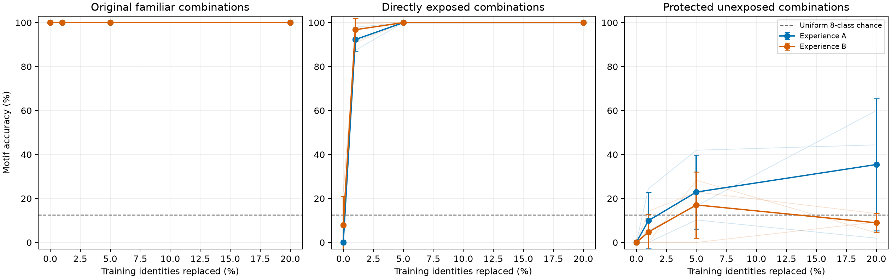

# Correlation-strength intervention

This experiment asks whether a few counterexamples to motif-position binding improve generalization to combinations that receive no counterexamples.

Every model uses 1,386 training identities and the same 120-epoch budget, architecture, losses, and optimizer as Hard v2. The zero-intervention checkpoints, predictions, and representations are reused byte for byte or derived from the archived source predictions; they are not retrained.

Counterexamples replace original training identities of the same motif. This preserves every motif prior and every original odd-motif identity. Even motifs 0, 2, 4, and 6 supply nested cell-2 counterexamples, balanced in a predeclared round-robin order and identical across experiences and seeds. Odd motifs 1, 3, 5, and 7 are never observed in cell 2 during training or validation.

The exposed test measures learning of combinations directly represented by counterexamples. The protected test measures transfer of that intervention to different motif types whose cell-2 combinations remain unseen. Both tests contain four true motif classes, while predictions still range over all eight classes. Uniform chance is therefore 12.5%, not 25%. Training-prior and training-majority baselines are retained in `baselines.csv`.

## Training-size and exposure audit

| Requested replacement | Identities replaced | Realized replacement | Training identities |
|---:|---:|---:|---:|
| 0% | 0 | 0.000% | 1386 |
| 1% | 14 | 1.010% | 1386 |
| 5% | 69 | 4.978% | 1386 |
| 20% | 277 | 19.986% | 1386 |

## Motif recognition

Values are means ± sample standard deviations across independent initialization seeds. Macro recall averages over classes present in each test; predictions are never restricted to those classes. No protected outcome selects a checkpoint, regularizer, intervention identity, or training duration.

| Experience | Replacement | Test | Accuracy (%) | Macro recall (%) |
|---|---:|---|---:|---:|
| A | 0% | exposed_common | 0.00 ± 0.00 | 0.00 ± 0.00 |
| A | 0% | iid | 100.00 ± 0.00 | 100.00 ± 0.00 |
| A | 0% | protected_common | 0.00 ± 0.00 | 0.00 ± 0.00 |
| A | 1% | exposed_common | 92.30 ± 5.29 | 92.13 ± 5.83 |
| A | 1% | iid | 100.00 ± 0.00 | 100.00 ± 0.00 |
| A | 1% | protected_common | 9.92 ± 12.82 | 9.89 ± 12.97 |
| A | 5% | exposed_common | 100.00 ± 0.00 | 100.00 ± 0.00 |
| A | 5% | iid | 100.00 ± 0.00 | 100.00 ± 0.00 |
| A | 5% | protected_common | 22.93 ± 16.78 | 22.04 ± 16.12 |
| A | 20% | exposed_common | 100.00 ± 0.00 | 100.00 ± 0.00 |
| A | 20% | iid | 100.00 ± 0.00 | 100.00 ± 0.00 |
| A | 20% | protected_common | 35.45 ± 30.04 | 33.65 ± 28.60 |
| B | 0% | exposed_common | 7.84 ± 13.22 | 8.48 ± 14.30 |
| B | 0% | iid | 100.00 ± 0.00 | 100.00 ± 0.00 |
| B | 0% | protected_common | 0.00 ± 0.00 | 0.00 ± 0.00 |
| B | 1% | exposed_common | 96.78 ± 5.22 | 96.92 ± 4.95 |
| B | 1% | iid | 100.00 ± 0.00 | 100.00 ± 0.00 |
| B | 1% | protected_common | 4.72 ± 8.17 | 5.14 ± 8.91 |
| B | 5% | exposed_common | 100.00 ± 0.00 | 100.00 ± 0.00 |
| B | 5% | iid | 100.00 ± 0.00 | 100.00 ± 0.00 |
| B | 5% | protected_common | 17.07 ± 15.03 | 17.53 ± 15.24 |
| B | 20% | exposed_common | 100.00 ± 0.00 | 100.00 ± 0.00 |
| B | 20% | iid | 100.00 ± 0.00 | 100.00 ± 0.00 |
| B | 20% | protected_common | 8.94 ± 4.40 | 8.40 ± 4.11 |

## Every seed

| Experience | Seed | Replacement | Test | Accuracy (%) | Macro recall (%) |
|---|---:|---:|---|---:|---:|
| A | 0 | 0% | iid | 100.00 | 100.00 |
| A | 0 | 0% | exposed_common | 0.00 | 0.00 |
| A | 0 | 0% | protected_common | 0.00 | 0.00 |
| A | 0 | 1% | iid | 100.00 | 100.00 |
| A | 0 | 1% | exposed_common | 97.90 | 98.02 |
| A | 0 | 1% | protected_common | 24.39 | 24.57 |
| A | 0 | 5% | iid | 100.00 | 100.00 |
| A | 0 | 5% | exposed_common | 100.00 | 100.00 |
| A | 0 | 5% | protected_common | 41.95 | 40.27 |
| A | 0 | 20% | iid | 100.00 | 100.00 |
| A | 0 | 20% | exposed_common | 100.00 | 100.00 |
| A | 0 | 20% | protected_common | 44.39 | 41.82 |
| B | 0 | 0% | iid | 100.00 | 100.00 |
| B | 0 | 0% | exposed_common | 0.00 | 0.00 |
| B | 0 | 0% | protected_common | 0.00 | 0.00 |
| B | 0 | 1% | iid | 100.00 | 100.00 |
| B | 0 | 1% | exposed_common | 99.58 | 99.55 |
| B | 0 | 1% | protected_common | 14.15 | 15.43 |
| B | 0 | 5% | iid | 100.00 | 100.00 |
| B | 0 | 5% | exposed_common | 100.00 | 100.00 |
| B | 0 | 5% | protected_common | 22.93 | 25.00 |
| B | 0 | 20% | iid | 100.00 | 100.00 |
| B | 0 | 20% | exposed_common | 100.00 | 100.00 |
| B | 0 | 20% | protected_common | 13.17 | 12.27 |
| A | 1 | 0% | iid | 100.00 | 100.00 |
| A | 1 | 0% | exposed_common | 0.00 | 0.00 |
| A | 1 | 0% | protected_common | 0.00 | 0.00 |
| A | 1 | 1% | iid | 100.00 | 100.00 |
| A | 1 | 1% | exposed_common | 91.60 | 92.01 |
| A | 1 | 1% | protected_common | 5.37 | 5.09 |
| A | 1 | 5% | iid | 100.00 | 100.00 |
| A | 1 | 5% | exposed_common | 100.00 | 100.00 |
| A | 1 | 5% | protected_common | 16.59 | 16.16 |
| A | 1 | 20% | iid | 100.00 | 100.00 |
| A | 1 | 20% | exposed_common | 100.00 | 100.00 |
| A | 1 | 20% | protected_common | 60.00 | 57.28 |
| B | 1 | 0% | iid | 100.00 | 100.00 |
| B | 1 | 0% | exposed_common | 23.11 | 25.00 |
| B | 1 | 0% | protected_common | 0.00 | 0.00 |
| B | 1 | 1% | iid | 100.00 | 100.00 |
| B | 1 | 1% | exposed_common | 90.76 | 91.21 |
| B | 1 | 1% | protected_common | 0.00 | 0.00 |
| B | 1 | 5% | iid | 100.00 | 100.00 |
| B | 1 | 5% | exposed_common | 100.00 | 100.00 |
| B | 1 | 5% | protected_common | 28.29 | 27.60 |
| B | 1 | 20% | iid | 100.00 | 100.00 |
| B | 1 | 20% | exposed_common | 100.00 | 100.00 |
| B | 1 | 20% | protected_common | 4.39 | 4.09 |
| A | 2 | 0% | iid | 100.00 | 100.00 |
| A | 2 | 0% | exposed_common | 0.00 | 0.00 |
| A | 2 | 0% | protected_common | 0.00 | 0.00 |
| A | 2 | 1% | iid | 100.00 | 100.00 |
| A | 2 | 1% | exposed_common | 87.39 | 86.36 |
| A | 2 | 1% | protected_common | 0.00 | 0.00 |
| A | 2 | 5% | iid | 100.00 | 100.00 |
| A | 2 | 5% | exposed_common | 100.00 | 100.00 |
| A | 2 | 5% | protected_common | 10.24 | 9.67 |
| A | 2 | 20% | iid | 100.00 | 100.00 |
| A | 2 | 20% | exposed_common | 100.00 | 100.00 |
| A | 2 | 20% | protected_common | 1.95 | 1.85 |
| B | 2 | 0% | iid | 100.00 | 100.00 |
| B | 2 | 0% | exposed_common | 0.42 | 0.45 |
| B | 2 | 0% | protected_common | 0.00 | 0.00 |
| B | 2 | 1% | iid | 100.00 | 100.00 |
| B | 2 | 1% | exposed_common | 100.00 | 100.00 |
| B | 2 | 1% | protected_common | 0.00 | 0.00 |
| B | 2 | 5% | iid | 100.00 | 100.00 |
| B | 2 | 5% | exposed_common | 100.00 | 100.00 |
| B | 2 | 5% | protected_common | 0.00 | 0.00 |
| B | 2 | 20% | iid | 100.00 | 100.00 |
| B | 2 | 20% | exposed_common | 100.00 | 100.00 |
| B | 2 | 20% | protected_common | 9.27 | 8.84 |

## Interpretation limits

An exposed-set improvement alone establishes direct combination learning. Improvement on protected combinations would support broader transfer, while poor protected performance would show that the intervention did not induce such transfer under this fixed budget. The parity partition evaluates one predeclared partition of motif types; it does not establish independence from motif chemistry or robustness to every possible partition. These behavioral curves alone do not locate information in particular layers or establish a causal representation mechanism.

The complete molecular selections are in `selection_audit.json`; per-seed three-task scores are in `behavior.csv`, individual predictions in `predictions.csv`, checkpoints and local/global representations in their respective directories, and source hashes in `source_reference.json`. The final epoch is fixed in advance; validation uses only original familiar combinations and does not select checkpoints.

