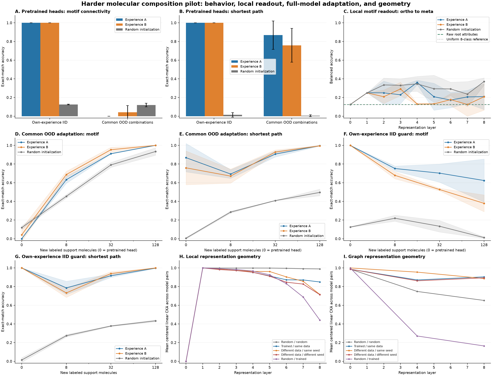
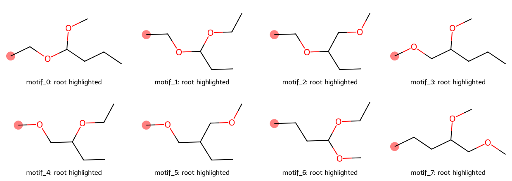

# Harder molecular composition pilot

This controlled local experiment tests whether graph models trained on different motif-position combinations expose local connectivity information that can be read across positions and used when adapting to held-out combinations. The measurements are descriptive and do not establish a causal representation mechanism or a molecular-property result.



Behavior, readout, and adaptation panels show means and sample standard deviations across encoder seeds. Support repetitions are averaged within each seed first; they do not increase the number of independently initialized encoders. Geometry curves show descriptive means across model pairs, which can share models and are not independent statistical replicates.

## Design and identity safeguards

The recorded dataset contains 6912 molecules and 6912 unique canonical identities. Molecules are partitioned by canonical identity before training; graph inputs do not expose alternative SMILES traversals as independent samples. The recorded identity-leakage check is `False`.

Eight nine-heavy-atom target sidechain motifs contain seven carbons and two ether oxygens and have equal multisets of ordinary input atom attributes, while their connectivity differs. Their marked attachment roots also have identical raw attributes. Element counts and other order-free ordinary atom-attribute bags therefore cannot identify the motif. Ortho, meta, and para query relationships, benzene and two pyridine scaffold variants, and a third distractor vary the molecular context. Query markers identify attachment and endpoint atoms. The model receives no oracle target-fragment mask. The local representation is the embedding at the marked target attachment atom; classification therefore requires information beyond that atom's ordinary attributes.

The combination partition uses `(motif + position) % 3`: Experience A pretrains only on residue 0, Experience B only on residue 1, and their common OOD evaluation uses residue 2. Each experience sees all eight motifs and all three positions but only one training position for each motif. This deliberately strong motif-position correlation makes shortcut use a serious risk. Both experiences use the same architecture, equal training counts, and matched training budgets. The common OOD evaluation includes all three positions and all eight motif classes, and its combination types are unseen by both experiences. A constant position predictor cannot solve it.

The supervised tasks classify target connectivity, classify the relative attachment position, and predict the exact shortest-path bond count from the marked anchor functional root to a marked target-sidechain carbon leaf. The leaf query varies by molecular identity between the nearest and farthest target carbon leaves relative to the target root. These are graph-structure tasks with computed answers; no experimental chemical-property labels, three-dimensional conformations, or stereochemical predictions are used.



Target fragments are drawn from recorded motif SMILES. The highlighted atom is the attachment root used for the single-atom local readout; the full molecule also supplies the ring and marked path endpoint.

| Split | Molecules |
| --- | --- |
| candidate_train | 4196 |
| train_a | 1386 |
| train_b | 1386 |
| val | 445 |
| val_a | 237 |
| val_b | 208 |
| discarded_val_ood | 238 |
| adaptation_reserve | 656 |
| adaptation_pool | 223 |
| adaptation_test | 443 |
| analysis | 1377 |
| iid_a | 462 |
| iid_b | 472 |
| ood_common | 443 |
| probe_source | 456 |
| probe_target | 455 |


Effective training counts: train_a = 1386, train_b = 1386.

Training is matched by motif count across experiences, while global position marginals can differ because each motif occurs at one position per experience. Matching total counts does not remove the designed motif-position correlation.

| Experience | Recorded training position counts |
| --- | --- |
| train_a | {"meta": 355, "ortho": 513, "para": 518} |
| train_b | {"meta": 513, "ortho": 518, "para": 355} |


The adaptation pool contains 223 canonical molecular identities. Exact support-pool identity overlap with pretraining is A = 0, B = 0. Support availability does not mean that these labels were used in pretraining.

## Pretrained-head behavior

Accuracy is exact-match accuracy; distance MAE is measured in bonds. The random-initialization rows include untrained encoders and untrained task heads, so they are initialization controls rather than fitted supervised baselines. All comparisons report seed variation, not a molecule-level confidence interval. In the figure, own-experience IID means `iid_a` for A and `iid_b` for B; the random reference averages its two IID split scores within seed. Those IID distributions differ, so the table reports both splits for every condition and the shared OOD set is the directly comparable challenge.

| Model | Split | Test molecules | Motif accuracy | Position accuracy | Distance accuracy | Distance MAE |
| --- | --- | --- | --- | --- | --- | --- |
| Experience A | iid_a | 462 | 100.0 +/- 0.0% (n=3) | 100.0 +/- 0.0% (n=3) | 100.0 +/- 0.0% (n=3) | 0.000 +/- 0.000 (n=3) |
| Experience A | iid_b | 472 | 0.5 +/- 0.9% (n=3) | 100.0 +/- 0.0% (n=3) | 79.9 +/- 19.7% (n=3) | 0.206 +/- 0.207 (n=3) |
| Experience A | ood_common | 443 | 0.0 +/- 0.0% (n=3) | 100.0 +/- 0.0% (n=3) | 86.8 +/- 15.2% (n=3) | 0.132 +/- 0.152 (n=3) |
| Experience B | iid_a | 462 | 2.1 +/- 3.6% (n=3) | 100.0 +/- 0.0% (n=3) | 83.6 +/- 12.8% (n=3) | 0.164 +/- 0.128 (n=3) |
| Experience B | iid_b | 472 | 100.0 +/- 0.0% (n=3) | 100.0 +/- 0.0% (n=3) | 100.0 +/- 0.0% (n=3) | 0.000 +/- 0.000 (n=3) |
| Experience B | ood_common | 443 | 4.2 +/- 7.1% (n=3) | 100.0 +/- 0.0% (n=3) | 75.9 +/- 18.1% (n=3) | 0.241 +/- 0.181 (n=3) |
| Random initialization | iid_a | 462 | 12.6 +/- 0.9% (n=3) | 31.6 +/- 8.0% (n=3) | 1.0 +/- 1.7% (n=3) | 7.207 +/- 2.871 (n=3) |
| Random initialization | iid_b | 472 | 12.4 +/- 0.2% (n=3) | 37.8 +/- 6.7% (n=3) | 1.8 +/- 3.1% (n=3) | 7.009 +/- 2.854 (n=3) |
| Random initialization | ood_common | 443 | 12.0 +/- 2.0% (n=3) | 37.4 +/- 1.6% (n=3) | 0.5 +/- 0.9% (n=3) | 7.433 +/- 2.972 (n=3) |


The matched-seed A-minus-B common OOD motif accuracy difference is -4.2 +/- 7.1 percentage points (n=3). This paired descriptive contrast compares training experiences; it does not isolate the causal effect of any representation feature.

The matched-seed A-minus-B common OOD distance accuracy difference is 10.9 +/- 31.5 percentage points (n=3). This paired descriptive contrast compares training experiences; it does not isolate the causal effect of any representation feature.

## Local cross-position connectivity readout

A standardized multiclass ridge readout fits ortho local representations and evaluates meta local representations on disjoint molecular identities. Normalization uses probe-training features only, and regularization is fixed before evaluating the target split. Balanced accuracy averages recall across target classes. Layer 0 is the input embedding; higher layers are message-passing outputs. The raw control uses the marked attachment atom's input attributes rather than an oracle fragment average. Readout fitting uses labeled source examples and is separate from encoder training.

The raw-root and random-encoder controls measure information accessible before learning. Random message passing can expose connectivity even when raw single-atom attributes cannot. A trained readout advantage indicates improved accessibility under this probe, and does not by itself demonstrate that the model uses that information for its task. Shuffled training labels provide an additional sample-label permutation control.

| Representation | Layer | Accuracy | Balanced accuracy | Shuffled-label accuracy |
| --- | --- | --- | --- | --- |
| Raw root attributes | Raw | 13.0% (n=1; SD undefined) | 12.5% (n=1; SD undefined) | 13.0% (n=1; SD undefined) |
| Experience A | 8 | 20.5 +/- 11.6% (n=3) | 21.0 +/- 13.9% (n=3) | 9.3 +/- 8.1% (n=3) |
| Experience B | 8 | 21.9 +/- 16.5% (n=3) | 20.8 +/- 14.4% (n=3) | 18.8 +/- 1.8% (n=3) |
| Random initialization | 8 | 37.1 +/- 3.1% (n=3) | 37.1 +/- 3.9% (n=3) | 12.8 +/- 7.0% (n=3) |


The raw-root control has 12.5% (n=1; SD undefined) balanced accuracy. Its single deterministic feature set has no encoder-initialization standard deviation.

At the final layer, Experience A minus the matched-seed random encoder has a cross-position balanced-accuracy difference of -16.2 +/- 17.7 percentage points (n=3). Positive and negative differences are both reported without treating high decoding as proof of functional reuse.

At the final layer, Experience B minus the matched-seed random encoder has a cross-position balanced-accuracy difference of -16.3 +/- 14.0 percentage points (n=3). Positive and negative differences are both reported without treating high decoding as proof of functional reuse.

## Full-model adaptation with the original heads

Zero shots reuses each model's original task heads without updating weights. Positive shot counts fine-tune the encoder and those same task heads, rather than fitting a new frozen-encoder ridge head. The random condition fine-tunes from initialization. Shot counts denote total newly labeled adaptation molecules, not examples per class. All conditions and seeds receive matched support identities; increasing counts use nested support subsets within each repetition. Support identities are excluded from both pretraining experiences and from the adaptation evaluation sets.

The common OOD curve must be assessed alongside the IID guard curve. Higher OOD accuracy accompanied by a large IID decrease can reflect specialization or forgetting rather than broadly useful transfer. This run does not replay pretraining data during adaptation. The exact adaptation steps, learning rate, support repetitions, and sampling seeds are recorded in the configuration and training logs. Both IID splits appear below; the figure's IID guard uses each experience's own IID split, as in the behavior panels.

| New labels | Initialization | Evaluation | Support repeats | Motif accuracy | Position accuracy | Distance accuracy | Distance MAE |
| --- | --- | --- | --- | --- | --- | --- | --- |
| 0 | Experience A | ood_common | 1 | 0.0 +/- 0.0% (n=3) | 100.0 +/- 0.0% (n=3) | 86.8 +/- 15.2% (n=3) | 0.132 +/- 0.152 (n=3) |
| 0 | Experience A | iid_a | 1 | 100.0 +/- 0.0% (n=3) | 100.0 +/- 0.0% (n=3) | 100.0 +/- 0.0% (n=3) | 0.000 +/- 0.000 (n=3) |
| 0 | Experience A | iid_b | 1 | 0.5 +/- 0.9% (n=3) | 100.0 +/- 0.0% (n=3) | 79.9 +/- 19.7% (n=3) | 0.206 +/- 0.207 (n=3) |
| 0 | Experience B | ood_common | 1 | 4.2 +/- 7.1% (n=3) | 100.0 +/- 0.0% (n=3) | 75.9 +/- 18.1% (n=3) | 0.241 +/- 0.181 (n=3) |
| 0 | Experience B | iid_a | 1 | 2.1 +/- 3.6% (n=3) | 100.0 +/- 0.0% (n=3) | 83.6 +/- 12.8% (n=3) | 0.164 +/- 0.128 (n=3) |
| 0 | Experience B | iid_b | 1 | 100.0 +/- 0.0% (n=3) | 100.0 +/- 0.0% (n=3) | 100.0 +/- 0.0% (n=3) | 0.000 +/- 0.000 (n=3) |
| 0 | Random initialization | ood_common | 1 | 12.0 +/- 2.0% (n=3) | 37.4 +/- 1.6% (n=3) | 0.5 +/- 0.9% (n=3) | 7.433 +/- 2.972 (n=3) |
| 0 | Random initialization | iid_a | 1 | 12.6 +/- 0.9% (n=3) | 31.6 +/- 8.0% (n=3) | 1.0 +/- 1.7% (n=3) | 7.207 +/- 2.871 (n=3) |
| 0 | Random initialization | iid_b | 1 | 12.4 +/- 0.2% (n=3) | 37.8 +/- 6.7% (n=3) | 1.8 +/- 3.1% (n=3) | 7.009 +/- 2.854 (n=3) |
| 8 | Experience A | ood_common | 3 | 63.3 +/- 3.9% (n=3) | 98.5 +/- 0.8% (n=3) | 69.3 +/- 4.6% (n=3) | 0.310 +/- 0.047 (n=3) |
| 8 | Experience A | iid_a | 3 | 75.2 +/- 2.7% (n=3) | 99.9 +/- 0.2% (n=3) | 78.6 +/- 7.1% (n=3) | 0.216 +/- 0.070 (n=3) |
| 8 | Experience A | iid_b | 3 | 15.3 +/- 2.9% (n=3) | 96.2 +/- 3.4% (n=3) | 61.1 +/- 2.8% (n=3) | 0.394 +/- 0.030 (n=3) |
| 8 | Experience B | ood_common | 3 | 68.7 +/- 3.4% (n=3) | 96.8 +/- 1.8% (n=3) | 67.1 +/- 7.5% (n=3) | 0.344 +/- 0.079 (n=3) |
| 8 | Experience B | iid_a | 3 | 21.9 +/- 2.1% (n=3) | 95.6 +/- 2.2% (n=3) | 66.5 +/- 6.3% (n=3) | 0.356 +/- 0.064 (n=3) |
| 8 | Experience B | iid_b | 3 | 67.9 +/- 3.7% (n=3) | 99.6 +/- 0.4% (n=3) | 73.2 +/- 4.8% (n=3) | 0.282 +/- 0.056 (n=3) |
| 8 | Random initialization | ood_common | 3 | 45.4 +/- 1.9% (n=3) | 60.7 +/- 5.3% (n=3) | 28.5 +/- 1.1% (n=3) | 1.056 +/- 0.069 (n=3) |
| 8 | Random initialization | iid_a | 3 | 21.1 +/- 3.6% (n=3) | 56.3 +/- 6.1% (n=3) | 29.0 +/- 1.9% (n=3) | 1.110 +/- 0.083 (n=3) |
| 8 | Random initialization | iid_b | 3 | 22.8 +/- 2.9% (n=3) | 49.9 +/- 6.9% (n=3) | 25.8 +/- 0.9% (n=3) | 1.199 +/- 0.083 (n=3) |
| 32 | Experience A | ood_common | 3 | 91.1 +/- 0.4% (n=3) | 100.0 +/- 0.0% (n=3) | 90.7 +/- 3.1% (n=3) | 0.094 +/- 0.031 (n=3) |
| 32 | Experience A | iid_a | 3 | 70.3 +/- 9.7% (n=3) | 100.0 +/- 0.0% (n=3) | 91.6 +/- 1.8% (n=3) | 0.085 +/- 0.020 (n=3) |
| 32 | Experience A | iid_b | 3 | 16.5 +/- 6.4% (n=3) | 99.1 +/- 1.5% (n=3) | 79.7 +/- 2.8% (n=3) | 0.204 +/- 0.029 (n=3) |
| 32 | Experience B | ood_common | 3 | 95.3 +/- 2.7% (n=3) | 99.8 +/- 0.2% (n=3) | 92.8 +/- 2.3% (n=3) | 0.080 +/- 0.015 (n=3) |
| 32 | Experience B | iid_a | 3 | 5.0 +/- 1.8% (n=3) | 99.2 +/- 1.0% (n=3) | 89.1 +/- 2.8% (n=3) | 0.117 +/- 0.019 (n=3) |
| 32 | Experience B | iid_b | 3 | 52.7 +/- 1.4% (n=3) | 100.0 +/- 0.1% (n=3) | 94.0 +/- 2.1% (n=3) | 0.066 +/- 0.025 (n=3) |
| 32 | Random initialization | ood_common | 3 | 79.1 +/- 2.7% (n=3) | 93.9 +/- 2.3% (n=3) | 40.9 +/- 0.3% (n=3) | 0.691 +/- 0.006 (n=3) |
| 32 | Random initialization | iid_a | 3 | 10.4 +/- 5.8% (n=3) | 92.3 +/- 3.0% (n=3) | 39.7 +/- 0.2% (n=3) | 0.736 +/- 0.004 (n=3) |
| 32 | Random initialization | iid_b | 3 | 16.4 +/- 6.5% (n=3) | 90.1 +/- 2.8% (n=3) | 35.9 +/- 1.2% (n=3) | 0.771 +/- 0.014 (n=3) |
| 128 | Experience A | ood_common | 3 | 100.0 +/- 0.0% (n=3) | 100.0 +/- 0.0% (n=3) | 99.7 +/- 0.4% (n=3) | 0.003 +/- 0.004 (n=3) |
| 128 | Experience A | iid_a | 3 | 62.3 +/- 23.0% (n=3) | 100.0 +/- 0.0% (n=3) | 99.8 +/- 0.3% (n=3) | 0.002 +/- 0.003 (n=3) |
| 128 | Experience A | iid_b | 3 | 11.3 +/- 2.0% (n=3) | 99.9 +/- 0.2% (n=3) | 94.6 +/- 4.2% (n=3) | 0.055 +/- 0.042 (n=3) |
| 128 | Experience B | ood_common | 3 | 100.0 +/- 0.0% (n=3) | 100.0 +/- 0.0% (n=3) | 99.5 +/- 0.4% (n=3) | 0.005 +/- 0.004 (n=3) |
| 128 | Experience B | iid_a | 3 | 1.4 +/- 1.5% (n=3) | 100.0 +/- 0.0% (n=3) | 98.6 +/- 1.3% (n=3) | 0.014 +/- 0.013 (n=3) |
| 128 | Experience B | iid_b | 3 | 37.9 +/- 9.0% (n=3) | 100.0 +/- 0.0% (n=3) | 100.0 +/- 0.0% (n=3) | 0.000 +/- 0.000 (n=3) |
| 128 | Random initialization | ood_common | 3 | 93.4 +/- 4.0% (n=3) | 100.0 +/- 0.0% (n=3) | 49.6 +/- 3.5% (n=3) | 0.542 +/- 0.058 (n=3) |
| 128 | Random initialization | iid_a | 3 | 0.6 +/- 0.9% (n=3) | 100.0 +/- 0.0% (n=3) | 43.5 +/- 0.7% (n=3) | 0.637 +/- 0.016 (n=3) |
| 128 | Random initialization | iid_b | 3 | 1.8 +/- 1.0% (n=3) | 100.0 +/- 0.0% (n=3) | 43.2 +/- 1.6% (n=3) | 0.630 +/- 0.025 (n=3) |


Changes below compare each adapted model against its own zero-shot baseline within the same seed. Support repetitions are averaged before taking the paired seed difference. Gains and retention are separate measurements; aggregate motif and distance accuracies do not identify the fraction of molecules correct on both tasks.

| New labels | Initialization | OOD motif change | OOD distance change | Own-IID motif change | Own-IID distance change |
| --- | --- | --- | --- | --- | --- |
| 8 | Experience A | 63.3 +/- 3.9 percentage points (n=3) | -17.5 +/- 10.6 percentage points (n=3) | -24.8 +/- 2.7 percentage points (n=3) | -21.4 +/- 7.1 percentage points (n=3) |
| 32 | Experience A | 91.1 +/- 0.4 percentage points (n=3) | 3.8 +/- 12.1 percentage points (n=3) | -29.7 +/- 9.7 percentage points (n=3) | -8.4 +/- 1.8 percentage points (n=3) |
| 128 | Experience A | 100.0 +/- 0.0 percentage points (n=3) | 12.8 +/- 14.8 percentage points (n=3) | -37.7 +/- 23.0 percentage points (n=3) | -0.2 +/- 0.3 percentage points (n=3) |
| 8 | Experience B | 64.5 +/- 4.5 percentage points (n=3) | -8.8 +/- 16.1 percentage points (n=3) | -32.1 +/- 3.7 percentage points (n=3) | -26.8 +/- 4.8 percentage points (n=3) |
| 32 | Experience B | 91.1 +/- 6.0 percentage points (n=3) | 16.9 +/- 16.0 percentage points (n=3) | -47.3 +/- 1.4 percentage points (n=3) | -6.0 +/- 2.1 percentage points (n=3) |
| 128 | Experience B | 95.8 +/- 7.1 percentage points (n=3) | 23.6 +/- 17.8 percentage points (n=3) | -62.1 +/- 9.0 percentage points (n=3) | 0.0 +/- 0.0 percentage points (n=3) |
| 8 | Random initialization | 33.5 +/- 2.9 percentage points (n=3) | 28.0 +/- 1.6 percentage points (n=3) | 9.5 +/- 3.1 percentage points (n=3) | 26.0 +/- 2.4 percentage points (n=3) |
| 32 | Random initialization | 67.1 +/- 2.2 percentage points (n=3) | 40.3 +/- 1.2 percentage points (n=3) | 0.9 +/- 6.0 percentage points (n=3) | 36.4 +/- 2.6 percentage points (n=3) |
| 128 | Random initialization | 81.5 +/- 2.2 percentage points (n=3) | 49.1 +/- 4.3 percentage points (n=3) | -11.3 +/- 0.5 percentage points (n=3) | 41.9 +/- 2.5 percentage points (n=3) |


## Representation geometry and initialization controls

Centered linear CKA and centered, Frobenius-normalized orthogonal Procrustes similarity compare identical ordered molecules at each layer. Local comparisons use the marked target attachment atom; graph comparisons use the recorded graph representation. The factorial controls separate same-data/different-seed, different-data/same-seed, and different-data/different-seed comparisons, alongside random/random and random/trained pairs. Neither similarity measure is required to increase with learning, and random encoders can already have high similarity.

The counts below are model-pair counts. Pairs reuse encoders and therefore do not provide independent replicates, confidence intervals, or evidence of statistical significance. Cross-experience same-seed comparisons can also reflect shared initialization. High CKA or Procrustes similarity alone does not establish functional transfer.

| Representation | Pair category | Layer | CKA (n=pairs) | Procrustes (n=pairs) |
| --- | --- | --- | --- | --- |
| graph | Random / random | 8 | 0.652 +/- 0.143 (n=3) | 0.867 +/- 0.047 (n=3) |
| graph | Trained / same data | 8 | 0.904 +/- 0.049 (n=6) | 0.957 +/- 0.014 (n=6) |
| graph | Different data / same seed | 8 | 0.886 +/- 0.084 (n=3) | 0.947 +/- 0.026 (n=3) |
| graph | Different data / different seed | 8 | 0.894 +/- 0.063 (n=6) | 0.950 +/- 0.020 (n=6) |
| graph | Random / trained | 8 | 0.164 +/- 0.069 (n=6) | 0.434 +/- 0.051 (n=6) |
| local | Random / random | 8 | 0.989 +/- 0.006 (n=3) | 0.983 +/- 0.003 (n=3) |
| local | Trained / same data | 8 | 0.850 +/- 0.057 (n=6) | 0.934 +/- 0.014 (n=6) |
| local | Different data / same seed | 8 | 0.716 +/- 0.062 (n=3) | 0.884 +/- 0.021 (n=3) |
| local | Different data / different seed | 8 | 0.713 +/- 0.079 (n=6) | 0.882 +/- 0.026 (n=6) |
| local | Random / trained | 8 | 0.441 +/- 0.141 (n=6) | 0.585 +/- 0.051 (n=6) |


## Interpretation and limits

Evidence for learned reusable local information requires an advantage over both raw-root and random-encoder readouts, behavior on genuinely held-out combination types, and useful adaptation with acceptable IID retention. These comparisons can disagree. Saturated readouts can occur before learning; similar geometry can coexist with poor transfer; and adaptation improvements can arise from supervision and optimization without identifying a local representation mechanism. No automatic positive conclusion is inferred from any one metric.

The chemical space remains a controlled synthetic aromatic scaffold grid with supplied query locations and a limited collection of backgrounds. Scaffold variants and distractors increase difficulty, but this is not a broad scaffold-held-out benchmark, experimental molecular-property prediction, or unknown-motif localization. Three seeds, when used, provide a small descriptive sample; no population-level correlation between geometry and transfer or causal explanation is established. The previous pilot archive remains separate from this experiment.

## Recorded configuration and artifacts

```json
{
  "adaptation_batch_size": 64,
  "adaptation_learning_rate": 0.0005,
  "adaptation_repeats": 3,
  "adaptation_replay": false,
  "adaptation_shots": [
    8,
    32,
    128
  ],
  "adaptation_steps": 80,
  "batch_size": 128,
  "cpu_threads": 4,
  "device": "auto",
  "epochs": 120,
  "experiment": "hard_v2",
  "geometry_examples": 512,
  "hidden_dim": 64,
  "layers": 8,
  "learning_rate": 0.0015,
  "probe_alpha": 1.0,
  "seeds": [
    0,
    1,
    2
  ],
  "split_seed": 20261030,
  "weight_decay": 0.0001
}
```

Recorded inputs: [config.json](config.json), [audit.json](audit.json), [environment.json](environment.json), [splits.json](splits.json), [behavior.csv](behavior.csv), [probes.csv](probes.csv), [adaptation.csv](adaptation.csv), and [similarities.csv](similarities.csv). Machine-readable aggregates: [report_summary.json](report_summary.json). Figures: [PNG](figures/hard_summary.png) and [SVG](figures/hard_summary.svg). Report regeneration changes only derived documentation and figures, preserving recorded measurements, model weights, and other archived scientific inputs.

Recorded device: `cuda`. Encoder and task-head parameters: 189531. Environment metadata fields: adaptation_protocol, checkpoint_selection, cuda_runtime, determinism, device, finished_utc, geometry_row_protocol, git_head_at_start, gpu, packages, parameter_count, platform, python, source_sha256, started_utc.
