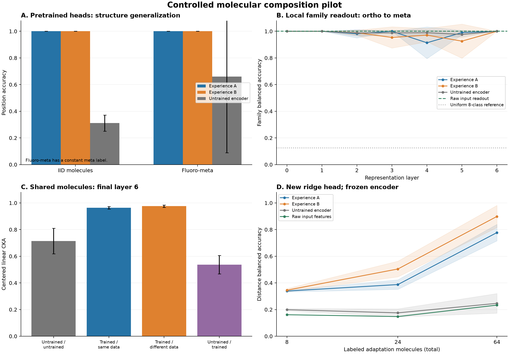

# Controlled molecular composition pilot

This local pilot tests whether small graph models trained on different molecular combinations expose reusable local structural information. It measures held-out behavior, linear readout, representation geometry, and frozen-encoder adaptation. These measurements are preliminary evidence; they do not establish a causal mechanism or a general chemistry result.



Panels A, B, and D show means and sample standard deviations across encoder seeds when at least two seeds are available. Adaptation repeats are averaged within each seed first. Panel C summarizes model pairs; pairs share models and are not independent statistical replicates. Fluoro-meta position labels are all meta, so a constant-meta predictor attains 100% there.

## Dataset and task scope

The enumerated dataset contains 3840 molecules and 3840 unique canonical identities. The saved audit records identity leakage as `False`. Distinct SMILES serializations of one canonical molecule belong to the same identity partition. The models consume atom graphs, so SMILES traversal is not a learned input convention in this pilot.

Eight terminal-group families vary across ortho, meta, and para attachment relationships, multiple reference-group backgrounds, and methylene spacers. The name 'fluoro family' includes terminal fluorine on a sidechain when `target_spacer > 0`; only `target_spacer = 0` means directly attached aryl-F. Direct aryl-F results are reported separately when recorded.

Experience A excludes all fluoro-meta candidate-training molecules. Experience B excludes chloro-meta instead. Both use the same architecture and the recorded matched training budget. IID testing excludes both held-out cells. The shared molecular partition separates candidate training, validation, and testing before experience exclusions and budget matching.

Atom features include ordinary atomic information and explicit query masks for the two ring attachment atoms, the two terminal-group root atoms, and the target fragment. The query and target fragment are supplied, so this pilot tests classification and structural relationships given localization; it does not establish discovery or localization of an unknown functional group. Exact distance labels are shortest-path bond counts between the marked terminal-group roots.

| Split | Molecules |
| --- | --- |
| candidate_train | 2472 |
| train_a | 2371 |
| train_b | 2371 |
| val | 335 |
| iid_test | 906 |
| ood_f_meta | 49 |
| ood_cl_meta | 44 |
| analysis | 999 |
| adaptation_pool | 92 |
| adaptation_test | 49 |
| probe_source | 346 |
| probe_target | 334 |
| discarded_val_ood | 34 |


Effective matched training counts: train_a = 2371, train_b = 2371.

Observed distance range: 3 to 11 bonds.

## Pretrained-head behavior

Values are mean +/- sample SD across encoder seeds; n is the number of seeds, not the number of molecules. Distance accuracy is exact-match accuracy, and distance MAE is measured in bonds. An untrained encoder with its untrained task heads is an initialization control, not a fitted supervised baseline.

| Model | Split | Test molecules | Family accuracy | Position accuracy | Distance accuracy | Distance MAE |
| --- | --- | --- | --- | --- | --- | --- |
| Experience A | iid_test | 906 | 100.0 +/- 0.0% (n=3) | 100.0 +/- 0.0% (n=3) | 100.0 +/- 0.0% (n=3) | 0.000 +/- 0.000 (n=3) |
| Experience A | ood_f_meta | 49 | 100.0 +/- 0.0% (n=3) | 100.0 +/- 0.0% (n=3) | 100.0 +/- 0.0% (n=3) | 0.000 +/- 0.000 (n=3) |
| Experience A | ood_cl_meta | 44 | 100.0 +/- 0.0% (n=3) | 100.0 +/- 0.0% (n=3) | 100.0 +/- 0.0% (n=3) | 0.000 +/- 0.000 (n=3) |
| Experience B | iid_test | 906 | 100.0 +/- 0.0% (n=3) | 100.0 +/- 0.0% (n=3) | 100.0 +/- 0.0% (n=3) | 0.000 +/- 0.000 (n=3) |
| Experience B | ood_f_meta | 49 | 100.0 +/- 0.0% (n=3) | 100.0 +/- 0.0% (n=3) | 100.0 +/- 0.0% (n=3) | 0.000 +/- 0.000 (n=3) |
| Experience B | ood_cl_meta | 44 | 100.0 +/- 0.0% (n=3) | 100.0 +/- 0.0% (n=3) | 100.0 +/- 0.0% (n=3) | 0.000 +/- 0.000 (n=3) |
| Untrained encoder | iid_test | 906 | 15.3 +/- 5.1% (n=3) | 31.1 +/- 6.0% (n=3) | 5.8 +/- 9.0% (n=3) | 4.700 +/- 2.413 (n=3) |
| Untrained encoder | ood_f_meta | 49 | 0.7 +/- 1.2% (n=3) | 66.0 +/- 57.2% (n=3) | 6.8 +/- 11.8% (n=3) | 4.653 +/- 2.806 (n=3) |
| Untrained encoder | ood_cl_meta | 44 | 21.2 +/- 36.7% (n=3) | 64.4 +/- 55.9% (n=3) | 8.3 +/- 14.4% (n=3) | 4.561 +/- 2.661 (n=3) |


Experience A's mean IID-minus-fluoro-meta position gap is 0.0 percentage points. The fluoro-meta cell has one position label; its position accuracy must be interpreted alongside variable shortest-path distances and the other held-out cell. It cannot, by itself, establish compositional reasoning.

### Direct aryl-F subset

| Model | Split | Test molecules | Family accuracy | Position accuracy | Distance accuracy | Distance MAE |
| --- | --- | --- | --- | --- | --- | --- |
| Experience A | ood_f_meta_direct_f | 12 | 100.0 +/- 0.0% (n=3) | 100.0 +/- 0.0% (n=3) | 100.0 +/- 0.0% (n=3) | 0.000 +/- 0.000 (n=3) |
| Experience B | ood_f_meta_direct_f | 12 | 100.0 +/- 0.0% (n=3) | 100.0 +/- 0.0% (n=3) | 100.0 +/- 0.0% (n=3) | 0.000 +/- 0.000 (n=3) |
| Untrained encoder | ood_f_meta_direct_f | 12 | 0.0 +/- 0.0% (n=3) | 66.7 +/- 57.7% (n=3) | 0.0 +/- 0.0% (n=3) | 3.694 +/- 1.206 (n=3) |


## Cross-condition linear readouts

The readout is a standardized multiclass ridge classifier with an unpenalized bias. Its normalization is fitted on probe-training features only, and its regularization is fixed before evaluating the probe target. Cross-position family readout fits ortho molecules and tests meta molecules with disjoint canonical identities, using target-fragment mean embeddings. Cross-family position readouts fit the six other target families and test the fluoro and chloro families. The graph version uses graph/query pooled features; the local version uses only target-fragment mean embeddings, testing whether local representations expose contextual positional information across target families. Readout fitting uses source labels, and is separate from encoder training. Representation layer 0 is the input embedding, and layers 1 through the final layer are message-passing outputs. The raw-input control has no encoder seed; its n=1 does not estimate initialization variability.

Raw input and untrained-encoder controls measure information accessible before learning. In particular, target-fragment query masks and atomic element features already expose strong family cues. High family readout accuracy alone therefore does not show that training created a reusable representation. Shuffled-label readouts are additional probe controls; they are simple sample-label permutations, not the word-type control task introduced in the cited probing paper.

| Probe | Representation | Layer | Accuracy | Balanced accuracy | Shuffled-label accuracy |
| --- | --- | --- | --- | --- | --- |
| cross_position_family | Raw input features | Raw | 100.0% (n=1; SD undefined) | 100.0% (n=1; SD undefined) | 10.2% (n=1; SD undefined) |
| cross_position_family | Experience A | 6 | 100.0 +/- 0.0% (n=3) | 100.0 +/- 0.0% (n=3) | 9.7 +/- 3.1% (n=3) |
| cross_position_family | Experience B | 6 | 100.0 +/- 0.0% (n=3) | 100.0 +/- 0.0% (n=3) | 9.8 +/- 5.3% (n=3) |
| cross_position_family | Untrained encoder | 6 | 100.0 +/- 0.0% (n=3) | 100.0 +/- 0.0% (n=3) | 14.3 +/- 3.5% (n=3) |
| cross_family_position | Raw input features | Raw | 37.3% (n=1; SD undefined) | 32.4% (n=1; SD undefined) | 27.4% (n=1; SD undefined) |
| cross_family_position | Experience A | 6 | 82.0 +/- 20.2% (n=3) | 80.8 +/- 20.4% (n=3) | 33.3 +/- 2.1% (n=3) |
| cross_family_position | Experience B | 6 | 100.0 +/- 0.0% (n=3) | 100.0 +/- 0.0% (n=3) | 34.0 +/- 3.2% (n=3) |
| cross_family_position | Untrained encoder | 6 | 82.3 +/- 22.9% (n=3) | 82.0 +/- 24.4% (n=3) | 35.0 +/- 5.0% (n=3) |
| cross_family_local_position | Raw input features | Raw | 31.5% (n=1; SD undefined) | 35.1% (n=1; SD undefined) | 27.0% (n=1; SD undefined) |
| cross_family_local_position | Experience A | 6 | 38.5 +/- 0.2% (n=3) | 35.9 +/- 2.3% (n=3) | 32.8 +/- 0.7% (n=3) |
| cross_family_local_position | Experience B | 6 | 40.4 +/- 2.8% (n=3) | 39.3 +/- 3.1% (n=3) | 29.5 +/- 4.3% (n=3) |
| cross_family_local_position | Untrained encoder | 6 | 32.5 +/- 4.6% (n=3) | 32.1 +/- 1.8% (n=3) | 30.3 +/- 4.9% (n=3) |


At the final layer, Experience A minus the untrained encoder has a mean cross-position family balanced-accuracy difference of 0.0 percentage points. This descriptive difference compares accessibility under the specified readout; it is not a causal attribution of the model's predictions.

The raw-input family readout reaches 100.0% (n=1; SD undefined) balanced accuracy. This baseline must be considered before attributing family decoding to representation learning.

## Representation geometry

Centered linear CKA and centered, Frobenius-normalized orthogonal Procrustes similarity compare mean target-fragment embeddings on the same ordered molecular examples. Procrustes is the nuclear norm of the normalized cross-covariance; higher values mean an easier orthogonal alignment. The statistics describe geometry rather than functional transfer, and neither is required to increase after training. Wide representations and common input structure can make untrained comparisons high.

The following spread is sample SD across model pairs. Because pairs can reuse a model, these counts do not provide independent confidence intervals or significance tests.

| Pair category | Layer | CKA (n=model pairs) | Procrustes (n=model pairs) |
| --- | --- | --- | --- |
| Untrained / untrained | 6 | 0.714 +/- 0.095 (n=3) | 0.857 +/- 0.032 (n=3) |
| Trained / same data | 6 | 0.964 +/- 0.010 (n=6) | 0.957 +/- 0.007 (n=6) |
| Trained / different data | 6 | 0.976 +/- 0.009 (n=3) | 0.972 +/- 0.003 (n=3) |
| Untrained / trained | 6 | 0.537 +/- 0.070 (n=6) | 0.708 +/- 0.013 (n=6) |


## Frozen-encoder adaptation

A new ridge distance-classification head is fitted from scratch on each labeled fluoro-meta adaptation sample while the encoder remains frozen. Shot counts denote total labeled molecules, not labels per class. Each held-out adaptation test molecule has a different canonical identity from every adaptation training molecule. The pretrained task head is not reused, and this experiment is neither full-model fine-tuning nor a measurement of pretrained-head sample efficiency. No zero-shot point is inserted into the ridge-head learning curve; zero-shot pretrained-head results appear in the behavior table above.

Experience A did not pretrain on the fluoro-meta adaptation pool. Experience B pretrained on 92 of the 92 adaptation-pool molecular identities. It is a seen-combination reference rather than an equally unseen transfer condition. Adaptation repetitions use the same support identities across conditions and seeds, and increasing shot counts uses nested subsets within each repetition. Repetitions vary labeled samples within an encoder seed; only seed-level averages contribute to the reported n and SD. Raw-feature adaptation uses one deterministic feature set, so its n=1 reports no initialization SD even though its labeled subsets are repeated.

| Total labels | Encoder | Repeats per seed | Distance accuracy | Distance balanced accuracy |
| --- | --- | --- | --- | --- |
| 8 | Experience A | 5 | 33.6 +/- 1.0% (n=3) | 33.9 +/- 0.6% (n=3) |
| 8 | Experience B | 5 | 35.0 +/- 1.2% (n=3) | 34.5 +/- 1.2% (n=3) |
| 8 | Untrained encoder | 5 | 20.3 +/- 0.9% (n=3) | 19.9 +/- 0.9% (n=3) |
| 8 | Raw input features | 5 | 17.6% (n=1; SD undefined) | 16.1% (n=1; SD undefined) |
| 24 | Experience A | 5 | 41.0 +/- 2.8% (n=3) | 38.8 +/- 3.6% (n=3) |
| 24 | Experience B | 5 | 52.7 +/- 5.5% (n=3) | 50.4 +/- 5.9% (n=3) |
| 24 | Untrained encoder | 5 | 19.0 +/- 2.9% (n=3) | 17.5 +/- 3.0% (n=3) |
| 24 | Raw input features | 5 | 16.7% (n=1; SD undefined) | 14.7% (n=1; SD undefined) |
| 64 | Experience A | 5 | 75.6 +/- 5.6% (n=3) | 77.8 +/- 6.2% (n=3) |
| 64 | Experience B | 5 | 88.4 +/- 8.8% (n=3) | 89.9 +/- 8.3% (n=3) |
| 64 | Untrained encoder | 5 | 24.1 +/- 5.1% (n=3) | 24.7 +/- 7.4% (n=3) |
| 64 | Raw input features | 5 | 26.9% (n=1; SD undefined) | 23.3% (n=1; SD undefined) |


With 8 labeled molecules, Experience A minus the untrained encoder has a mean distance balanced-accuracy difference of 14.0 percentage points. The complete curve and seed variation above determine how broadly this observed difference holds; no significance test or causal claim is implied.

## Interpretation and limits

This run demonstrates whether the controlled pipeline is executable and quantifies each specified comparison. Evidence for learned functional reuse requires a trained advantage over raw and untrained baselines on genuinely unseen molecular identities and combinations, together with a corresponding adaptation benefit. High CKA, high family decoding, or a single held-out-cell position score is insufficient. The present observational comparisons do not isolate which internal features cause predictions or adaptation gains.

The chemical space is a synthetic disubstituted-benzene grid with supplied query locations, not a benchmark of realistic molecular properties or unlabeled motif discovery. There are no experimental property labels, no scaffold-diverse evaluation, and no three-dimensional or stereochemical task. Multiple seeds reduce initialization ambiguity, but a small pilot cannot support a stable relationship between representation geometry and transfer. A larger study should predefine more held-out family-position-background combinations, add simple graph-derived task baselines, use more seeds and scaffolds, and test interventions before claiming that a particular shared representation explains transfer.

## Recorded configuration and artifacts

```json
{
  "adaptation_repeats": 5,
  "adaptation_shots": [
    8,
    24,
    64
  ],
  "batch_size": 128,
  "cpu_threads": 4,
  "device": "auto",
  "epochs": 60,
  "experiment": "pilot_v1",
  "hidden_dim": 64,
  "layers": 6,
  "learning_rate": 0.002,
  "probe_alpha": 1.0,
  "seeds": [
    0,
    1,
    2
  ],
  "split_seed": 20261030,
  "weight_decay": 0.0001
}
```

The raw inputs to this report are [config.json](config.json), [audit.json](audit.json), [environment.json](environment.json), [behavior.csv](behavior.csv), [probes.csv](probes.csv), [similarities.csv](similarities.csv), and [adaptation.csv](adaptation.csv). [report_summary.json](report_summary.json) stores machine-readable aggregates. The figure is available as [PNG](figures/pilot_summary.png) and [SVG](figures/pilot_summary.svg). Checkpoints and full training records, when saved by the runner, remain the scientific record; this report generator changes only derived documentation and figures.

Recorded device: `cuda`. Encoder and task-head parameter count: 164183. Environment metadata fields recorded: cuda_runtime, determinism, device, finished_utc, git_head_at_start, gpu, packages, parameter_count, platform, python, source_sha256, started_utc.

## Primary methodological references

- Canonical molecular identity and randomized SMILES options: [RDKit MolToSmiles API](https://rdkit.org/docs/source/rdkit.Chem.rdmolfiles.html#rdkit.Chem.rdmolfiles.MolToSmiles). Identity grouping here uses canonicalization rather than treating SMILES strings as independent molecules.
- Representation similarity: Kornblith et al. (2019), [Similarity of Neural Network Representations Revisited](https://proceedings.mlr.press/v97/kornblith19a.html). This motivates CKA as a geometric comparison; functional reuse is assessed separately in this pilot.
- Probe controls: Hewitt and Liang (2019), [Designing and Interpreting Probes with Control Tasks](https://aclanthology.org/D19-1275/). The paper motivates interpreting probe performance relative to controls; this pilot's sample-label shuffle is a simpler control and does not reproduce their word-type construction.
