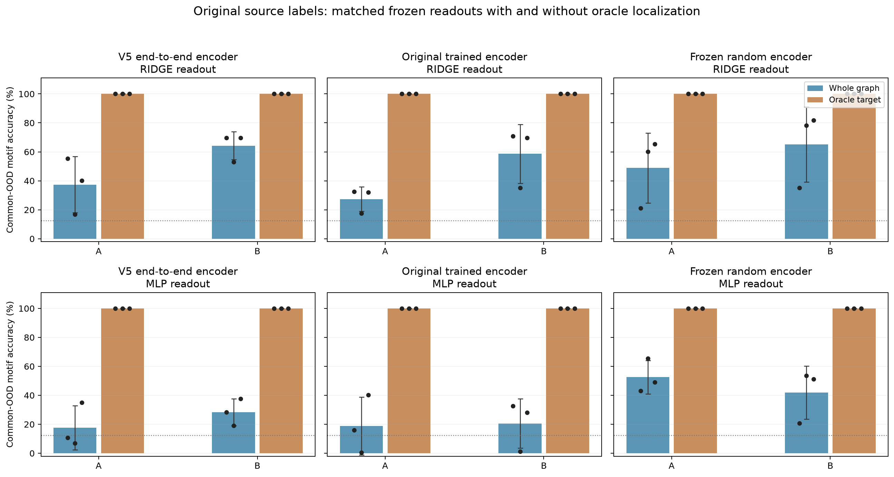
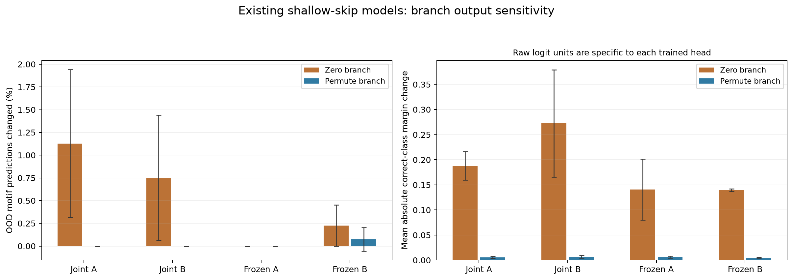

# Frozen-model branch sensitivity and pooling diagnostics

This record separates output sensitivity of the completed v5 classifiers from two new frozen-feature fitting protocols. No encoder or architecture is trained. Known target membership is supplied only to the oracle diagnostic pool. Source-only fits and separately labeled cross-position probes are different experiments.

## Original-source-label readouts

Each fit uses exactly the experience's original 1,386 training identities and motif labels. The whole-graph vector is the actual 64D layer-1 feature appended to the v5 classifier; it is checked against the archived v5 vector. The oracle-target vector averages the nine annotated substituent atoms at the same layer, with the same full molecular input and encoder. It supplies additional localization information. Both pools use support-only standardization and a matched readout: fixed-alpha-1 multiclass ridge, or a fresh 64-to-64-to-8 ReLU classifier. MLP initialization and all original training orders are matched across pools; every fit receives 120 epochs. All settings and the final epoch are fixed before observing OOD outcomes.

The new MLP uses motif-only loss, whereas v5 trained three task heads jointly. Comparisons between the two pools hold this diagnostic fitting protocol fixed. Comparisons with the original v5 classifier additionally change its fitting conditions. Oracle performance is conditional on supplied boundaries and is a diagnostic upper bound, not a boundary-free prediction result.

The co-primary diagnostic endpoints below are ordinary common-OOD motif accuracy for each fixed classifier. Entries are percentages, or percentage points for the paired oracle-minus-whole contrast, as mean +/- sample SD across 3 seeds. Seed contrasts are computed before aggregation. A/B and encoder regimes remain separate.

| Encoder | Experience | Readout | Whole graph (%) | Oracle target (%) | Paired gain (pp) |
| --- | --- | --- | --- | --- | --- |
| V5 end-to-end encoder | A | RIDGE | 37.4 +/- 19.5 | 100.0 +/- 0.0 | 62.6 +/- 19.5 |
| V5 end-to-end encoder | A | MLP | 17.6 +/- 15.2 | 100.0 +/- 0.0 | 82.4 +/- 15.2 |
| V5 end-to-end encoder | B | RIDGE | 64.2 +/- 9.6 | 100.0 +/- 0.0 | 35.8 +/- 9.6 |
| V5 end-to-end encoder | B | MLP | 28.4 +/- 9.4 | 100.0 +/- 0.0 | 71.6 +/- 9.4 |
| Original trained encoder | A | RIDGE | 27.4 +/- 8.5 | 100.0 +/- 0.0 | 72.6 +/- 8.5 |
| Original trained encoder | A | MLP | 18.9 +/- 20.0 | 100.0 +/- 0.0 | 81.1 +/- 20.0 |
| Original trained encoder | B | RIDGE | 58.6 +/- 20.3 | 100.0 +/- 0.0 | 41.4 +/- 20.3 |
| Original trained encoder | B | MLP | 20.5 +/- 17.0 | 100.0 +/- 0.0 | 79.5 +/- 17.0 |
| Frozen random encoder | A | RIDGE | 48.9 +/- 24.1 | 100.0 +/- 0.0 | 51.1 +/- 24.1 |
| Frozen random encoder | A | MLP | 52.5 +/- 11.6 | 100.0 +/- 0.0 | 47.5 +/- 11.6 |
| Frozen random encoder | B | RIDGE | 65.1 +/- 25.9 | 100.0 +/- 0.0 | 34.9 +/- 25.9 |
| Frozen random encoder | B | MLP | 41.8 +/- 18.3 | 100.0 +/- 0.0 | 58.2 +/- 18.3 |

Fit accuracy, both IID guards, ordinary and balanced accuracy, all individual seeds, and readout states remain in the machine-readable record. The random encoder is shared across A/B fits; those are not six independent initializations. Frozen-v5 encoders are the original trained encoders. Uniform eight-output guessing has expected accuracy 12.5%, distinct from measured random-encoder performance.

## Separately labeled cross-position probes

These standardized alpha-1 ridge fits reuse the exact archived v4 supports: 256 balanced labels from one source position, three draws, tested on the other positions. A source support can contain combinations excluded from original encoder training. No target-position label occurs in its directed fit, but this is additional diagnostic supervision and is not the original-source-only task protocol.

The table reports balanced accuracy on all target-position analysis examples. First average all six directions and all support draws within each seed, then report mean +/- sample SD across encoder seeds. Directions and draws are not independent seeds. The shared random all-analysis reference is counted once.

| Encoder | Experience | Whole graph (%) | Oracle target (%) |
| --- | --- | --- | --- |
| V5 end-to-end encoder | A | 48.4 +/- 12.7 | 100.0 +/- 0.0 |
| V5 end-to-end encoder | B | 57.9 +/- 13.0 | 100.0 +/- 0.0 |
| Original trained encoder | A | 54.4 +/- 25.0 | 100.0 +/- 0.0 |
| Original trained encoder | B | 50.4 +/- 1.7 | 100.0 +/- 0.0 |
| Frozen random encoder | SHARED | 74.2 +/- 7.9 | 100.0 +/- 0.0 |

## Existing branch outputs

Correct-class margin is `z[y] - max(z[k] for k != y)`. Margin delta is altered minus intact; positive values favor the truth. Every saved intact, zeroed, and permuted class prediction must reproduce v5 before analysis. Deep coordinates and final heads remain fixed. The following table uses the shallow branch and common-OOD motif head. Flip rates use all test examples. Each mean is first computed within model; uncertainty is sample SD across seeds. Signed averages can cancel large individual changes, so absolute changes and centered-logit distances are retained too.

| Encoder | Experience | Intervention | Predictions changed (%) | Mean margin delta | Mean absolute delta | Mean centered-logit L2 |
| --- | --- | --- | --- | --- | --- | --- |
| V5 end-to-end encoder | A | zero_branch | 1.129 +/- 0.814 | 0.06089 +/- 0.02885 | 0.18792 +/- 0.02845 | 0.45126 +/- 0.12879 |
| V5 end-to-end encoder | A | permuted_branch | 0.000 +/- 0.000 | 0.00102 +/- 0.00160 | 0.00552 +/- 0.00188 | 0.01377 +/- 0.00448 |
| V5 end-to-end encoder | B | zero_branch | 0.752 +/- 0.690 | 0.09655 +/- 0.01811 | 0.27237 +/- 0.10660 | 0.77662 +/- 0.24557 |
| V5 end-to-end encoder | B | permuted_branch | 0.000 +/- 0.000 | 0.00041 +/- 0.00029 | 0.00687 +/- 0.00285 | 0.01756 +/- 0.00703 |
| Original trained encoder | A | zero_branch | 0.000 +/- 0.000 | 0.07751 +/- 0.03318 | 0.14091 +/- 0.06072 | 0.38043 +/- 0.05883 |
| Original trained encoder | A | permuted_branch | 0.000 +/- 0.000 | 0.00016 +/- 0.00126 | 0.00608 +/- 0.00205 | 0.01613 +/- 0.00719 |
| Original trained encoder | B | zero_branch | 0.226 +/- 0.226 | 0.06059 +/- 0.05199 | 0.13961 +/- 0.00259 | 0.39678 +/- 0.04449 |
| Original trained encoder | B | permuted_branch | 0.075 +/- 0.130 | 0.00045 +/- 0.00040 | 0.00484 +/- 0.00055 | 0.01558 +/- 0.00311 |

Raw margins and distances are specific to each trained head's logit scale, rather than calibrated effect sizes across models. Complete per-example values, quantiles, correct-to-wrong and wrong-to-correct transitions, accuracy-neutral wrong-label changes, relative centered-logit distances, all three tasks, both IID sets, and the full analysis set remain in `branch/`. Unchanged accuracy alone cannot establish branch nonuse. Replacement features can be outside the fitted joint distribution and do not provide an additive causal decomposition.

## Interpretation and provenance

An oracle-versus-whole advantage under the matched source-only readout supports localization/pooling as a limitation for that setup. It does not prove that whole-graph averaging erased all useful information. A successful whole-graph cross-position probe alongside a failing original-source-label fit would additionally implicate differences in supervision or learned rule selection. If both fail, the concrete decoder and fitting protocol must be considered before inferring unavailable information. Strong motif-position binding allows different rules to fit original labels equally well.

All encoders, original records, and identity partitions remain frozen. `pooling/pooling_plan.json` preserves exact supports and test identities, `pooling_source_paired.csv` preserves individual paired contrasts, and `pooling_direct_seed.csv` preserves within-seed directed-probe aggregates. Source references, execution environment, fit inventory, features, logits, predictions, and this report are covered by the new manifest. Large representations and readout checkpoints remain local. This diagnostic concerns eight known synthetic motifs and three initialization seeds; it does not test unseen motif topology.

Execution source commit: `8a5e6997e7bff4ebc1e0d6438a9847fd8623dee2`.
