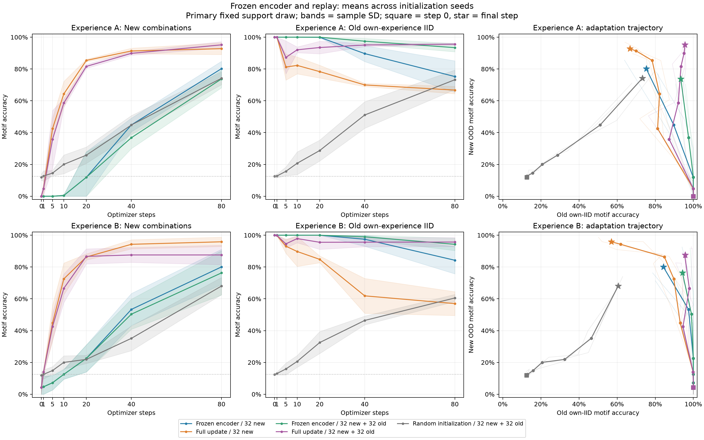
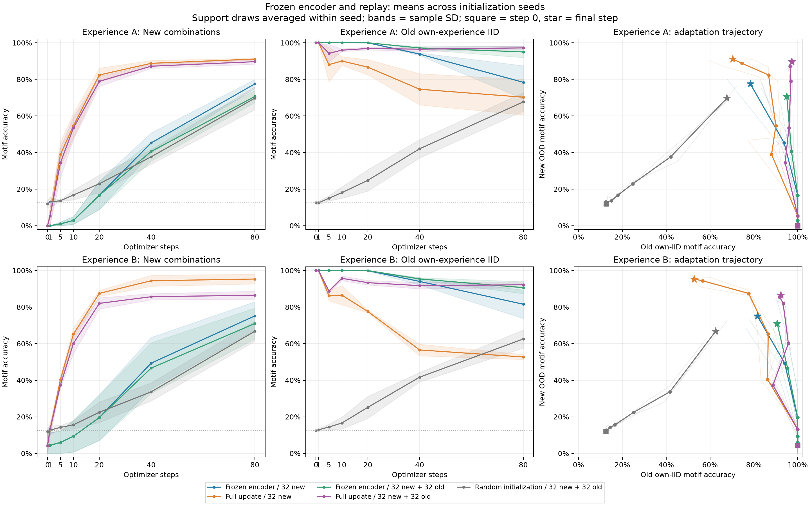

# Frozen encoder and old-example replay experiment

This experiment asks whether updating inherited task heads on fixed learned features can resolve held-out motif-position combinations, and whether replay changes the tradeoff between adaptation and old-combination performance. It compares interventions under a fixed optimizer-step budget and reports new and old accuracy separately. It does not infer feature absence from a failed readout or establish a causal mechanism from representation similarity.



The primary comparison and figure use the one fixed support set with repeat = 0, shared across arms and initialization seeds. Other support repetitions are supplemental robustness checks. Tables and shaded bands show means and sample standard deviations across seeds; three support draws on each of three seeds still give n=3 initialization replicates. The faint tradeoff curves show individual seeds. The square marks step 0 and the star the final checkpoint; intervening circles follow increasing optimizer steps. These curves are adaptation trajectories, not an optimized Pareto frontier.

## Matched design and label accounting

Every arm receives the same 32 new molecular identities for a given support repetition, reused from the archived hard-v2 32-shot support draw. Replay arms additionally receive the same fixed 32 old training identities within an experience and repetition. Old identities differ between experiences because their pretraining sets differ. Support identities are excluded from the independent new and old evaluation sets. Replaying old labels requires access to 32 previously labeled molecules: the new-only arms use 32 distinct labels per adaptation run, while replay arms use 64 distinct labels, of which 32 are reused pretraining labels. They have equal numbers of optimizer updates, rather than equal total example presentations or equal data access.

The encoder comprises the atom-input embedding and all message-passing layers. Frozen arms hold every encoder parameter fixed and train all three inherited MLP task heads, including their hidden layers, for motif, position, and path-distance classification. Full-update arms train that encoder and those same inherited heads. The scratch arm trains the complete randomly initialized model and its random task heads on the same replay support; its archived initialization is matched to the corresponding hard-v2 random seed. No task head is reset in the pretrained arms. Thus the frozen intervention is inherited-MLP adaptation, rather than a reset final linear layer.

The final predeclared checkpoint is step 80; recorded evaluation checkpoints are 0, 1, 5, 10, 20, 40, 80. Each update uses the entire support set: 32 examples in new-only arms and 64 examples in replay arms. With 32 new and 32 old examples, the ordinary full-batch loss gives equal new/old weight. All three task losses contribute to training. Fixed-step matching does not match floating-point work, because frozen encoders and different batch sizes have different costs. No test-based checkpoint selection is performed.

The new test is `ood_common`; the old test is `iid_a` for Experience A and `iid_b` for Experience B. Both IID splits, when recorded, remain available in the machine-readable files. The old tests have different distributions across experiences; the shared OOD test is the common challenge. Final accuracies below therefore retain the experience label rather than pooling A and B.

| Experience | Support repetition | Unique new identities | Unique old identities | New/old identity overlap |
| --- | --- | --- | --- | --- |
| A | 0 | 32 | 32 | 0 |
| B | 0 | 32 | 32 | 0 |
| A | 1 | 32 | 32 | 0 |
| B | 1 | 32 | 32 | 0 |
| A | 2 | 32 | 32 | 0 |
| B | 2 | 32 | 32 | 0 |


## Final motif accuracy and retention

Primary comparison, using only the predeclared fixed support repetition 0:

| Experience | Adaptation arm | New OOD motif accuracy | Old own-IID motif accuracy | Old change from own step 0 |
| --- | --- | --- | --- | --- |
| A | Frozen encoder / 32 new | 80.2 +/- 4.7% (n=3) | 75.3 +/- 9.9% (n=3) | -24.7 +/- 9.9 percentage points (n=3) |
| A | Full update / 32 new | 92.8 +/- 3.7% (n=3) | 66.7 +/- 2.3% (n=3) | -33.3 +/- 2.3 percentage points (n=3) |
| A | Frozen encoder / 32 new + 32 old | 73.7 +/- 5.5% (n=3) | 93.4 +/- 2.6% (n=3) | -6.6 +/- 2.6 percentage points (n=3) |
| A | Full update / 32 new + 32 old | 95.2 +/- 2.0% (n=3) | 95.6 +/- 0.8% (n=3) | -4.4 +/- 0.8 percentage points (n=3) |
| A | Random initialization / 32 new + 32 old | 74.2 +/- 4.1% (n=3) | 73.2 +/- 6.1% (n=3) | 60.7 +/- 6.0 percentage points (n=3) |
| B | Frozen encoder / 32 new | 80.1 +/- 11.1% (n=3) | 84.3 +/- 8.5% (n=3) | -15.7 +/- 8.5 percentage points (n=3) |
| B | Full update / 32 new | 95.9 +/- 2.9% (n=3) | 57.0 +/- 7.5% (n=3) | -43.0 +/- 7.5 percentage points (n=3) |
| B | Frozen encoder / 32 new + 32 old | 76.3 +/- 13.9% (n=3) | 94.3 +/- 3.9% (n=3) | -5.7 +/- 3.9 percentage points (n=3) |
| B | Full update / 32 new + 32 old | 87.6 +/- 6.1% (n=3) | 95.7 +/- 2.8% (n=3) | -4.3 +/- 2.8 percentage points (n=3) |
| B | Random initialization / 32 new + 32 old | 68.0 +/- 5.4% (n=3) | 60.5 +/- 2.2% (n=3) | 48.1 +/- 2.4 percentage points (n=3) |


Supplemental summary, averaging all support repetitions within each seed:

| Experience | Adaptation arm | New OOD motif accuracy | Old own-IID motif accuracy | Old change from own step 0 |
| --- | --- | --- | --- | --- |
| A | Frozen encoder / 32 new | 77.5 +/- 2.5% (n=3) | 78.4 +/- 9.1% (n=3) | -21.6 +/- 9.1 percentage points (n=3) |
| A | Full update / 32 new | 91.1 +/- 0.4% (n=3) | 70.3 +/- 9.7% (n=3) | -29.7 +/- 9.7 percentage points (n=3) |
| A | Frozen encoder / 32 new + 32 old | 70.6 +/- 3.3% (n=3) | 95.0 +/- 3.1% (n=3) | -5.0 +/- 3.1 percentage points (n=3) |
| A | Full update / 32 new + 32 old | 89.7 +/- 1.4% (n=3) | 97.2 +/- 1.0% (n=3) | -2.8 +/- 1.0 percentage points (n=3) |
| A | Random initialization / 32 new + 32 old | 69.7 +/- 6.3% (n=3) | 67.7 +/- 5.0% (n=3) | 55.1 +/- 5.2 percentage points (n=3) |
| B | Frozen encoder / 32 new | 75.2 +/- 7.8% (n=3) | 81.5 +/- 7.8% (n=3) | -18.5 +/- 7.8 percentage points (n=3) |
| B | Full update / 32 new | 95.3 +/- 2.7% (n=3) | 52.7 +/- 1.4% (n=3) | -47.3 +/- 1.4 percentage points (n=3) |
| B | Frozen encoder / 32 new + 32 old | 71.0 +/- 8.4% (n=3) | 90.6 +/- 3.3% (n=3) | -9.4 +/- 3.3 percentage points (n=3) |
| B | Full update / 32 new + 32 old | 86.5 +/- 2.2% (n=3) | 92.2 +/- 1.7% (n=3) | -7.8 +/- 1.7 percentage points (n=3) |
| B | Random initialization / 32 new + 32 old | 66.8 +/- 5.5% (n=3) | 62.5 +/- 5.0% (n=3) | 50.1 +/- 5.0 percentage points (n=3) |




The supplemental figure averages the support draws within each seed before showing the initialization mean and sample SD. Faint new-versus-old traces are individual seed averages over the draws.

For pretrained arms, old-IID decrease relative to their own step-zero model measures forgetting on that distribution. The scratch arm starts without pretrained performance; its change from step zero is learning from random initialization and is not a measure of forgetting. Separate new and old accuracies do not give the fraction of individual molecules correct on both distributions.

Matched-seed and matched-support contrasts below report current-arm minus reference-arm final motif accuracy. Support-draw differences are averaged within seed before computing the seed mean and sample SD. They are descriptive contrasts without significance claims.

| Experience | Paired contrast | Evaluation split | Motif accuracy difference |
| --- | --- | --- | --- |
| A | Frozen encoder / 32 new + 32 old minus Frozen encoder / 32 new | ood_common | -6.9 +/- 5.7 percentage points (n=3) |
| A | Frozen encoder / 32 new + 32 old minus Frozen encoder / 32 new | iid_a | 16.6 +/- 6.8 percentage points (n=3) |
| A | Full update / 32 new + 32 old minus Full update / 32 new | ood_common | -1.4 +/- 1.0 percentage points (n=3) |
| A | Full update / 32 new + 32 old minus Full update / 32 new | iid_a | 27.0 +/- 8.8 percentage points (n=3) |
| A | Full update / 32 new + 32 old minus Frozen encoder / 32 new + 32 old | ood_common | 19.1 +/- 4.1 percentage points (n=3) |
| A | Full update / 32 new + 32 old minus Frozen encoder / 32 new + 32 old | iid_a | 2.2 +/- 4.1 percentage points (n=3) |
| A | Full update / 32 new + 32 old minus Random initialization / 32 new + 32 old | ood_common | 20.0 +/- 7.3 percentage points (n=3) |
| A | Full update / 32 new + 32 old minus Random initialization / 32 new + 32 old | iid_a | 29.5 +/- 5.5 percentage points (n=3) |
| B | Frozen encoder / 32 new + 32 old minus Frozen encoder / 32 new | ood_common | -4.2 +/- 0.7 percentage points (n=3) |
| B | Frozen encoder / 32 new + 32 old minus Frozen encoder / 32 new | iid_b | 9.1 +/- 4.6 percentage points (n=3) |
| B | Full update / 32 new + 32 old minus Full update / 32 new | ood_common | -8.9 +/- 2.9 percentage points (n=3) |
| B | Full update / 32 new + 32 old minus Full update / 32 new | iid_b | 39.5 +/- 2.1 percentage points (n=3) |
| B | Full update / 32 new + 32 old minus Frozen encoder / 32 new + 32 old | ood_common | 15.5 +/- 6.7 percentage points (n=3) |
| B | Full update / 32 new + 32 old minus Frozen encoder / 32 new + 32 old | iid_b | 1.6 +/- 3.2 percentage points (n=3) |
| B | Full update / 32 new + 32 old minus Random initialization / 32 new + 32 old | ood_common | 19.7 +/- 7.1 percentage points (n=3) |
| B | Full update / 32 new + 32 old minus Random initialization / 32 new + 32 old | iid_b | 29.7 +/- 6.6 percentage points (n=3) |


## All tasks and each initialization seed

Joint accuracy is the fraction of evaluated molecules whose motif, position, and distance predictions are all correct. It is computed per molecule before aggregation. Distance MAE is in bonds. All accuracies are exact-match fractions, and the reported SD describes initialization variation rather than a molecule-level confidence interval.

| Experience | Arm | Evaluation | Motif | Position | Distance | All-three joint | Distance MAE |
| --- | --- | --- | --- | --- | --- | --- | --- |
| A | Frozen encoder / 32 new | New common OOD | 77.5 +/- 2.5% (n=3) | 100.0 +/- 0.0% (n=3) | 93.7 +/- 6.3% (n=3) | 75.1 +/- 4.0% (n=3) | 0.0627 +/- 0.0631 (n=3) |
| A | Frozen encoder / 32 new | Old own IID | 78.4 +/- 9.1% (n=3) | 100.0 +/- 0.0% (n=3) | 98.5 +/- 1.7% (n=3) | 76.9 +/- 7.9% (n=3) | 0.0152 +/- 0.0168 (n=3) |
| A | Full update / 32 new | New common OOD | 91.1 +/- 0.4% (n=3) | 100.0 +/- 0.0% (n=3) | 90.7 +/- 3.1% (n=3) | 83.7 +/- 2.5% (n=3) | 0.0936 +/- 0.0311 (n=3) |
| A | Full update / 32 new | Old own IID | 70.3 +/- 9.7% (n=3) | 100.0 +/- 0.0% (n=3) | 91.6 +/- 1.8% (n=3) | 63.3 +/- 8.2% (n=3) | 0.0854 +/- 0.0203 (n=3) |
| A | Frozen encoder / 32 new + 32 old | New common OOD | 70.6 +/- 3.3% (n=3) | 100.0 +/- 0.0% (n=3) | 93.7 +/- 6.5% (n=3) | 67.9 +/- 3.8% (n=3) | 0.0630 +/- 0.0650 (n=3) |
| A | Frozen encoder / 32 new + 32 old | Old own IID | 95.0 +/- 3.1% (n=3) | 100.0 +/- 0.0% (n=3) | 99.3 +/- 1.2% (n=3) | 94.3 +/- 3.5% (n=3) | 0.0067 +/- 0.0117 (n=3) |
| A | Full update / 32 new + 32 old | New common OOD | 89.7 +/- 1.4% (n=3) | 100.0 +/- 0.0% (n=3) | 91.0 +/- 2.8% (n=3) | 81.7 +/- 3.5% (n=3) | 0.0903 +/- 0.0277 (n=3) |
| A | Full update / 32 new + 32 old | Old own IID | 97.2 +/- 1.0% (n=3) | 100.0 +/- 0.0% (n=3) | 98.8 +/- 0.8% (n=3) | 96.0 +/- 1.0% (n=3) | 0.0118 +/- 0.0087 (n=3) |
| A | Random initialization / 32 new + 32 old | New common OOD | 69.7 +/- 6.3% (n=3) | 98.4 +/- 1.2% (n=3) | 43.7 +/- 2.1% (n=3) | 29.7 +/- 3.2% (n=3) | 0.6268 +/- 0.0302 (n=3) |
| A | Random initialization / 32 new + 32 old | Old own IID | 67.7 +/- 5.0% (n=3) | 98.7 +/- 0.7% (n=3) | 45.1 +/- 0.3% (n=3) | 30.9 +/- 1.4% (n=3) | 0.6231 +/- 0.0110 (n=3) |
| B | Frozen encoder / 32 new | New common OOD | 75.2 +/- 7.8% (n=3) | 100.0 +/- 0.0% (n=3) | 94.6 +/- 6.7% (n=3) | 72.3 +/- 4.2% (n=3) | 0.0537 +/- 0.0674 (n=3) |
| B | Frozen encoder / 32 new | Old own IID | 81.5 +/- 7.8% (n=3) | 100.0 +/- 0.0% (n=3) | 98.3 +/- 3.0% (n=3) | 79.8 +/- 4.8% (n=3) | 0.0174 +/- 0.0302 (n=3) |
| B | Full update / 32 new | New common OOD | 95.3 +/- 2.7% (n=3) | 99.8 +/- 0.2% (n=3) | 92.8 +/- 2.3% (n=3) | 88.8 +/- 3.0% (n=3) | 0.0795 +/- 0.0151 (n=3) |
| B | Full update / 32 new | Old own IID | 52.7 +/- 1.4% (n=3) | 100.0 +/- 0.1% (n=3) | 94.0 +/- 2.1% (n=3) | 48.8 +/- 1.6% (n=3) | 0.0661 +/- 0.0250 (n=3) |
| B | Frozen encoder / 32 new + 32 old | New common OOD | 71.0 +/- 8.4% (n=3) | 100.0 +/- 0.0% (n=3) | 95.3 +/- 6.9% (n=3) | 68.3 +/- 4.8% (n=3) | 0.0474 +/- 0.0695 (n=3) |
| B | Frozen encoder / 32 new + 32 old | Old own IID | 90.6 +/- 3.3% (n=3) | 100.0 +/- 0.0% (n=3) | 100.0 +/- 0.0% (n=3) | 90.6 +/- 3.3% (n=3) | 0.0000 +/- 0.0000 (n=3) |
| B | Full update / 32 new + 32 old | New common OOD | 86.5 +/- 2.2% (n=3) | 99.8 +/- 0.3% (n=3) | 96.4 +/- 2.5% (n=3) | 83.5 +/- 0.5% (n=3) | 0.0361 +/- 0.0242 (n=3) |
| B | Full update / 32 new + 32 old | Old own IID | 92.2 +/- 1.7% (n=3) | 100.0 +/- 0.0% (n=3) | 99.7 +/- 0.4% (n=3) | 91.9 +/- 1.7% (n=3) | 0.0031 +/- 0.0041 (n=3) |
| B | Random initialization / 32 new + 32 old | New common OOD | 66.8 +/- 5.5% (n=3) | 99.0 +/- 0.3% (n=3) | 44.7 +/- 0.4% (n=3) | 30.1 +/- 2.3% (n=3) | 0.6170 +/- 0.0033 (n=3) |
| B | Random initialization / 32 new + 32 old | Old own IID | 62.5 +/- 5.0% (n=3) | 99.5 +/- 0.3% (n=3) | 42.0 +/- 2.1% (n=3) | 26.7 +/- 1.4% (n=3) | 0.6497 +/- 0.0261 (n=3) |


The following seed values average support repetitions; individual support draws remain in `trajectory.csv`. [Final seed-level measurements](final_seed_metrics.csv) and [all checkpoint seed-level measurements](trajectory_seed_metrics.csv) retain full numerical precision and all recorded test splits.

| Experience | Arm | Seed | New OOD motif | Old own-IID motif |
| --- | --- | --- | --- | --- |
| A | Frozen encoder / 32 new | 0 | 77.7% | 83.8% |
| A | Frozen encoder / 32 new | 1 | 79.8% | 67.9% |
| A | Frozen encoder / 32 new | 2 | 74.9% | 83.5% |
| A | Full update / 32 new | 0 | 90.6% | 59.1% |
| A | Full update / 32 new | 1 | 91.3% | 76.6% |
| A | Full update / 32 new | 2 | 91.3% | 75.0% |
| A | Frozen encoder / 32 new + 32 old | 0 | 70.9% | 98.3% |
| A | Frozen encoder / 32 new + 32 old | 1 | 67.2% | 92.1% |
| A | Frozen encoder / 32 new + 32 old | 2 | 73.7% | 94.5% |
| A | Full update / 32 new + 32 old | 0 | 88.2% | 96.2% |
| A | Full update / 32 new + 32 old | 1 | 91.0% | 98.2% |
| A | Full update / 32 new + 32 old | 2 | 89.8% | 97.3% |
| A | Random initialization / 32 new + 32 old | 0 | 76.4% | 72.2% |
| A | Random initialization / 32 new + 32 old | 1 | 68.8% | 68.5% |
| A | Random initialization / 32 new + 32 old | 2 | 63.9% | 62.3% |
| B | Frozen encoder / 32 new | 0 | 73.2% | 77.8% |
| B | Frozen encoder / 32 new | 1 | 83.7% | 90.5% |
| B | Frozen encoder / 32 new | 2 | 68.5% | 76.3% |
| B | Full update / 32 new | 0 | 96.6% | 53.0% |
| B | Full update / 32 new | 1 | 97.1% | 51.2% |
| B | Full update / 32 new | 2 | 92.2% | 54.0% |
| B | Frozen encoder / 32 new + 32 old | 0 | 68.7% | 88.8% |
| B | Frozen encoder / 32 new + 32 old | 1 | 80.4% | 94.4% |
| B | Frozen encoder / 32 new + 32 old | 2 | 64.0% | 88.7% |
| B | Full update / 32 new + 32 old | 0 | 84.6% | 90.3% |
| B | Full update / 32 new + 32 old | 1 | 88.9% | 92.8% |
| B | Full update / 32 new + 32 old | 2 | 85.9% | 93.5% |
| B | Random initialization / 32 new + 32 old | 0 | 73.0% | 68.0% |
| B | Random initialization / 32 new + 32 old | 1 | 64.6% | 61.4% |
| B | Random initialization / 32 new + 32 old | 2 | 62.8% | 58.3% |


## Where forgetting can occur

If old accuracy falls while the encoder is bitwise fixed, the changed task heads are sufficient to produce that behavioral loss on the fixed representation. This does not mean the representation contains no old information. If the full model changes, encoder drift and head drift can both accompany forgetting; their coexistence does not determine which change caused the loss. The crossed-state tests below assess functional compatibility conditional on the other component. Even failed swaps can reflect a changed feature coordinate system and coadaptation rather than information loss.

Recorded frozen-encoder checks: 252 rows, 0 reporting changed encoder parameters, maximum recorded absolute encoder-parameter delta = 0.0. Of 252 rows containing original and current encoder SHA-256 hashes, 252 have matching hashes. A zero parameter delta is distinct from this hash-based bitwise check; the saved hashes provide the stronger identity evidence where recorded.

Parameter deltas compare each adaptation state with that run's own step-zero state. A maximum absolute delta is over parameter entries within a run; values below then average support repetitions within seed. CKA, when recorded, compares the same ordered held-out molecules before and after adaptation and describes representational geometry. High CKA can coexist with changed parameters or changed behavior and does not establish useful reuse.

| Experience | Arm | Encoder maximum delta | Task-head maximum delta | Graph CKA | Local CKA |
| --- | --- | --- | --- | --- | --- |
| A | Frozen encoder / 32 new | 0.0000 +/- 0.0000 (n=3) | 0.0495 +/- 0.0023 (n=3) | 1.0000 +/- 0.0000 (n=3) | 1.0000 +/- 0.0000 (n=3) |
| A | Full update / 32 new | 0.0356 +/- 0.0017 (n=3) | 0.0414 +/- 0.0006 (n=3) | 0.9225 +/- 0.0313 (n=3) | 0.7679 +/- 0.1037 (n=3) |
| A | Frozen encoder / 32 new + 32 old | 0.0000 +/- 0.0000 (n=3) | 0.0503 +/- 0.0008 (n=3) | 1.0000 +/- 0.0000 (n=3) | 1.0000 +/- 0.0000 (n=3) |
| A | Full update / 32 new + 32 old | 0.0374 +/- 0.0036 (n=3) | 0.0414 +/- 0.0024 (n=3) | 0.9391 +/- 0.0205 (n=3) | 0.7976 +/- 0.1246 (n=3) |
| A | Random initialization / 32 new + 32 old | 0.0522 +/- 0.0011 (n=3) | 0.0510 +/- 0.0015 (n=3) | 0.4099 +/- 0.0963 (n=3) | 0.8480 +/- 0.1079 (n=3) |
| B | Frozen encoder / 32 new | 0.0000 +/- 0.0000 (n=3) | 0.0513 +/- 0.0018 (n=3) | 1.0000 +/- 0.0000 (n=3) | 1.0000 +/- 0.0000 (n=3) |
| B | Full update / 32 new | 0.0338 +/- 0.0015 (n=3) | 0.0426 +/- 0.0040 (n=3) | 0.9489 +/- 0.0156 (n=3) | 0.6996 +/- 0.1351 (n=3) |
| B | Frozen encoder / 32 new + 32 old | 0.0000 +/- 0.0000 (n=3) | 0.0518 +/- 0.0020 (n=3) | 1.0000 +/- 0.0000 (n=3) | 1.0000 +/- 0.0000 (n=3) |
| B | Full update / 32 new + 32 old | 0.0378 +/- 0.0012 (n=3) | 0.0433 +/- 0.0023 (n=3) | 0.9514 +/- 0.0206 (n=3) | 0.6994 +/- 0.1157 (n=3) |
| B | Random initialization / 32 new + 32 old | 0.0523 +/- 0.0007 (n=3) | 0.0520 +/- 0.0004 (n=3) | 0.3996 +/- 0.1128 (n=3) | 0.8499 +/- 0.1113 (n=3) |


### Crossed encoder and task-head states

The following primary-support table recombines step-zero and final components without additional fitting. `E0` and `H0` are the pretrained encoder and all three pretrained task heads; `E1` and `H1` are their adapted counterparts. It uses only support repetition 0. The full saved file includes the other pretrained arms, all support repetitions, all tasks, and all recorded splits; random-scratch runs are excluded from this intervention.

| Experience | Adaptation arm | Recombined state | New OOD motif | Old own-IID motif |
| --- | --- | --- | --- | --- |
| A | Full update / 32 new | E0_H0 | 0.0 +/- 0.0% (n=3) | 100.0 +/- 0.0% (n=3) |
| A | Full update / 32 new | E0_H1 | 2.7 +/- 2.4% (n=3) | 100.0 +/- 0.0% (n=3) |
| A | Full update / 32 new | E1_H0 | 74.3 +/- 8.8% (n=3) | 90.5 +/- 6.3% (n=3) |
| A | Full update / 32 new | E1_H1 | 92.8 +/- 3.7% (n=3) | 66.7 +/- 2.3% (n=3) |
| A | Full update / 32 new + 32 old | E0_H0 | 0.0 +/- 0.0% (n=3) | 100.0 +/- 0.0% (n=3) |
| A | Full update / 32 new + 32 old | E0_H1 | 1.5 +/- 1.6% (n=3) | 100.0 +/- 0.0% (n=3) |
| A | Full update / 32 new + 32 old | E1_H0 | 62.4 +/- 5.9% (n=3) | 98.9 +/- 1.7% (n=3) |
| A | Full update / 32 new + 32 old | E1_H1 | 95.2 +/- 2.0% (n=3) | 95.6 +/- 0.8% (n=3) |
| B | Full update / 32 new | E0_H0 | 4.2 +/- 7.1% (n=3) | 100.0 +/- 0.0% (n=3) |
| B | Full update / 32 new | E0_H1 | 12.9 +/- 10.8% (n=3) | 100.0 +/- 0.0% (n=3) |
| B | Full update / 32 new | E1_H0 | 67.3 +/- 8.1% (n=3) | 88.1 +/- 8.7% (n=3) |
| B | Full update / 32 new | E1_H1 | 95.9 +/- 2.9% (n=3) | 57.0 +/- 7.5% (n=3) |
| B | Full update / 32 new + 32 old | E0_H0 | 4.2 +/- 7.1% (n=3) | 100.0 +/- 0.0% (n=3) |
| B | Full update / 32 new + 32 old | E0_H1 | 10.6 +/- 10.1% (n=3) | 100.0 +/- 0.0% (n=3) |
| B | Full update / 32 new + 32 old | E1_H0 | 55.2 +/- 3.8% (n=3) | 97.3 +/- 4.5% (n=3) |
| B | Full update / 32 new + 32 old | E1_H1 | 87.6 +/- 6.1% (n=3) | 95.7 +/- 2.8% (n=3) |


Comparing `E0_H1` with `E0_H0` measures the effect of the changed task heads conditional on the original encoder. Comparing `E1_H0` with `E0_H0` measures the changed encoder conditional on the original task heads. The fully adapted `E1_H1` may behave differently from either swap because representations and task heads can coadapt. A failed crossed state does not prove that the encoder lost information: an altered feature basis can make an otherwise informative representation incompatible with the other task heads. These conditional interventions localize functional compatibility and do not give an additive causal decomposition of forgetting.

### Fresh frozen-feature ridge readout

As an optimization diagnostic, a fresh standardized linear ridge readout with predeclared regularization alpha = 1 is fit to the original frozen encoder features. This table uses the primary support repetition 0. Normalization and readout fitting use support data only. Local features are the marked attachment atom's final-layer embedding; graph features are the original pooled task-head input. New-only and replay fits use the same support identities as the neural interventions. This is a separate readout family, rather than additional steps of the inherited MLP or a replication of DFR.

| Experience | Frozen features | Labeled support | New OOD motif | Old own-IID motif |
| --- | --- | --- | --- | --- |
| A | graph | new | 100.0 +/- 0.0% (n=3) | 0.0 +/- 0.0% (n=3) |
| A | graph | replay | 93.4 +/- 2.5% (n=3) | 94.7 +/- 4.2% (n=3) |
| A | local | new | 100.0 +/- 0.0% (n=3) | 0.0 +/- 0.0% (n=3) |
| A | local | replay | 74.9 +/- 5.6% (n=3) | 57.0 +/- 2.8% (n=3) |
| B | graph | new | 100.0 +/- 0.0% (n=3) | 2.5 +/- 4.3% (n=3) |
| B | graph | replay | 90.4 +/- 2.8% (n=3) | 89.8 +/- 2.1% (n=3) |
| B | local | new | 100.0 +/- 0.0% (n=3) | 7.3 +/- 4.7% (n=3) |
| B | local | replay | 62.8 +/- 1.0% (n=3) | 63.5 +/- 5.9% (n=3) |


If this fresh readout succeeds where inherited-head adaptation fails, that difference supports an optimization or readout explanation under the tested features and regularization. A graph readout advantage does not by itself establish local information at the attachment atom. Failure of both tested readouts still cannot prove feature absence at all layers or under all readout families.

## Diagnostic controls and limits

There are eight motif classes, so uniform random class prediction has expected accuracy 1/8 = 12.5%. A fitted probe on random-encoder features is a different baseline: message passing can expose graph information before training, and its previously reported approximately 37.1% balanced accuracy is not a theoretical chance level. A label-shuffled probe measures a further empirical control. Probe results must be read by layer and seed; a weak probe at one layer or under one optimization setting cannot show that every layer lacks local information.

Successful frozen-encoder adaptation with retention would support the existence of information usable by these task heads under this support and optimization protocol. Failure at the fixed budget would only show that this inherited-head procedure did not recover it. Additional steps, a reset readout, regularization, or a different probe may change the result. If full updating outperforms freezing, the observed improvement requires the tested encoder updates relative to this specific frozen-head procedure; it does not prove that no successful frozen readout exists. Scratch performance is essential when assessing whether rapid learning actually benefits from pretraining.

Position-only prediction and a local-input positive control are complementary diagnostics. Each position can support two or three training motif classes in this partition, so the relation is not a one-to-one position-to-class mapping. With eight classes across three positions, deterministic position-only prediction has a 3/8 = 37.5% balanced-accuracy ceiling when all supported class recalls are considered. Agreement with one empirical majority-class predictor and compatibility with the full training-supported class set measure different things. A position-based classifier can reproduce a shortcut without identifying the actual computation inside the neural model. A local-input model can demonstrate an available local solution while using a different input protocol. An oracle-local subgraph with repeated motif graph types tests local solvability, rather than generalization to unseen motif topologies. Neither diagnostic alone resolves whether the original model uses local information. The deliberately strong motif-position association, supplied query locations, eight synthetic target motifs, fixed optimizer budget, and small number of initialization seeds limit generalization of these results.

The complementary diagnostics have their own scientific record: [position shortcuts, local-input positive control, and all-layer probe controls](../mechanism_diagnostics_v3/REPORT.md). Its oracle-local input protocol and per-seed, per-layer probe tables should be read alongside this intervention rather than pooled into its neural adaptation arms.

Work on spurious correlations motivates testing whether useful information survives shortcut-dependent prediction: [Kirichenko, Izmailov, and Wilson, ICLR 2023](https://arxiv.org/abs/2204.02937) found that retraining the last layer can improve robustness on their studied benchmarks. The present inherited-MLP molecular intervention differs from that method and is not a replication. [Qiu, Kuang, and Goel, ICML 2024](https://proceedings.mlr.press/v235/qiu24e.html) varied spurious-feature complexity and correlation strength in a controlled feature-learning study, motivating a subsequent molecular correlation-strength intervention. Neither paper establishes the outcome of this experiment.

No correlation-strength sweep is inferred from this five-arm comparison. A subsequent fixed-size training intervention should distinguish directly exposed target combinations from a second set of combinations that remains entirely unexposed, so improvements in few-shot learning and broader combination generalization can be assessed separately.

## Recorded configuration and reproducibility

```json
{
  "adaptation_learning_rate": 0.0005,
  "batch_size": 128,
  "correlation_rates": [
    0.0,
    0.01,
    0.05,
    0.2
  ],
  "correlation_train_count": 1386,
  "cpu_threads": 4,
  "device": "auto",
  "diagnostic_examples": 128,
  "epochs": 120,
  "evaluation_steps": [
    0,
    1,
    5,
    10,
    20,
    40,
    80
  ],
  "experiment": "mechanism_v3",
  "hidden_dim": 64,
  "layers": 8,
  "learning_rate": 0.0015,
  "mechanism_steps": 80,
  "new_count": 32,
  "old_count": 32,
  "primary_repeat": 0,
  "probe_alpha": 1.0,
  "seeds": [
    0,
    1,
    2
  ],
  "source": "experiments/hard_v2",
  "support_repeats": [
    0,
    1,
    2
  ],
  "weight_decay": 0.0001
}
```

Recorded device: `cuda`. Parameter count: unrecorded. Environment fields: device, finished_utc, frozen_scope, git_head_at_start, gpu, packages, platform, pretrained_checkpoint_sha256, primary_repeat, python, source_directory, source_manifest_sha256, source_sha256, started_utc, training_protocol.

Recorded inputs: [config.json](config.json), [environment.json](environment.json), [support_sets.json](support_sets.json), [trajectory.csv](trajectory.csv), [drift.csv](drift.csv), [component_eval.csv](component_eval.csv), [ridge_diagnostic.csv](ridge_diagnostic.csv). Derived artifacts: [machine-readable summary](report_summary.json), [final seed metrics](final_seed_metrics.csv), [trajectory seed metrics](trajectory_seed_metrics.csv), primary [PNG](figures/mechanism_summary.png) and [SVG](figures/mechanism_summary.svg), supplemental [PNG](figures/mechanism_support_robustness.png) and [SVG](figures/mechanism_support_robustness.svg). Report regeneration changes only derived documentation, aggregates, and figures. It preserves recorded measurements, support identities, model weights, and the original pilot archives.
