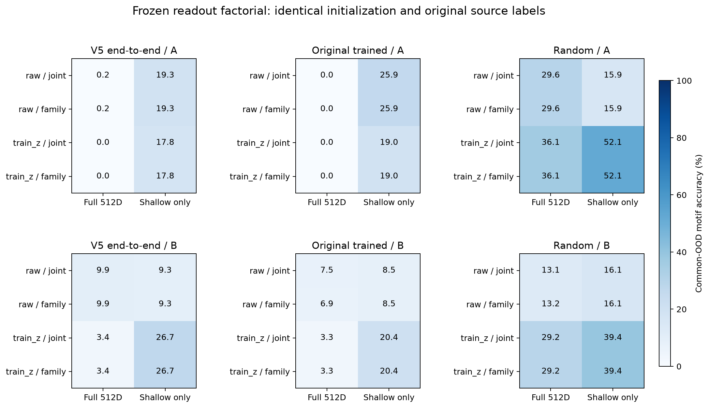
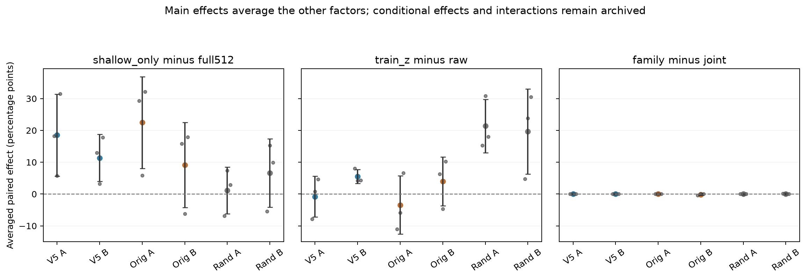

# Frozen readout factors and matched random controls

This diagnostic holds molecular identity splits, original source labels, encoder states, head initialization, and fitting budgets fixed. It compares readout input scope, feature standardization, and the frozen-head task objective. It adds no target-combination labels or target-fragment membership. The scope of attribution is this fixed factorial protocol, not a unique decomposition of the earlier v5-to-v6 change.

## Fixed comparison and its limits

The MLP grid crosses full512 versus shallow_only, raw versus train_z, and joint versus family. Full512 is the actual v5 readout, comprising 448 deep coordinates and 64 shallow coordinates. Shallow_only zeros its first 448 coordinates while preserving a 512-dimensional head, so input width and head parameters remain identical. Every head starts from the same archived seed-matched random first 448 weights and zero appended 64 columns. This differs from the standalone 64D MLP initializer used in v6. Train_z fits each coordinate's mean and population SD on original training identities only; raw preserves the original feature scale.

All MLP source fits use the same 1,386 identities and stored epoch orders per experience, with 120 epochs, batches of 128, AdamW learning rate 0.0015, weight decay 0.0001, and global gradient clipping at 5. No encoder parameter is updated. Joint sums the original family, position, and distance cross entropies; family uses only family cross entropy with the same coefficient. The available source annotations are identical; the objective determines which of them are used. Auxiliary predictions from untrained family-only heads are marked as untrained and are not meaningful task comparisons.

The task heads have no shared trainable parameters when the encoder is frozen. The other task losses therefore contribute no raw family-head gradient. Their only update coupling here is the original global gradient clip, with floating-point execution as a numerical consideration. Objective differences cannot establish multitask semantic interference or shared-feature learning. Per-update total and family gradient norms, clipping coefficients, and clip counts remain archived.

Every table entry is ordinary common-OOD motif accuracy in percent, mean +/- sample SD across 3 encoder seeds. A/B and encoder regimes remain separate. The same random encoder is reused across A/B fits and does not create six independent initializations. Complete training and both IID guards, balanced scores, original task metrics, individual seeds, and all predictions remain in the record.

## Complete fixed MLP grid

| Scope | Normalization | Objective | V5 end-to-end A | V5 end-to-end B | Original trained A | Original trained B | Random A | Random B |
| --- | --- | --- | --- | --- | --- | --- | --- | --- |
| full512 | raw | joint | 0.2 +/- 0.3 | 9.9 +/- 3.2 | 0.0 +/- 0.0 | 7.5 +/- 6.6 | 29.6 +/- 4.0 | 13.1 +/- 7.2 |
| full512 | raw | family | 0.2 +/- 0.3 | 9.9 +/- 3.2 | 0.0 +/- 0.0 | 6.9 +/- 6.3 | 29.6 +/- 4.0 | 13.2 +/- 7.5 |
| full512 | train_z | joint | 0.0 +/- 0.0 | 3.4 +/- 5.9 | 0.0 +/- 0.0 | 3.3 +/- 5.7 | 36.1 +/- 4.0 | 29.2 +/- 5.0 |
| full512 | train_z | family | 0.0 +/- 0.0 | 3.4 +/- 5.9 | 0.0 +/- 0.0 | 3.3 +/- 5.7 | 36.1 +/- 4.0 | 29.2 +/- 5.0 |
| shallow_only | raw | joint | 19.3 +/- 12.5 | 9.3 +/- 4.3 | 25.9 +/- 14.3 | 8.5 +/- 0.9 | 15.9 +/- 3.0 | 16.1 +/- 2.9 |
| shallow_only | raw | family | 19.3 +/- 12.5 | 9.3 +/- 4.3 | 25.9 +/- 14.3 | 8.5 +/- 0.9 | 15.9 +/- 3.0 | 16.1 +/- 2.9 |
| shallow_only | train_z | joint | 17.8 +/- 16.0 | 26.7 +/- 6.6 | 19.0 +/- 19.4 | 20.4 +/- 16.4 | 52.1 +/- 11.9 | 39.4 +/- 16.9 |
| shallow_only | train_z | family | 17.8 +/- 16.0 | 26.7 +/- 6.6 | 19.0 +/- 19.4 | 20.4 +/- 16.4 | 52.1 +/- 11.9 | 39.4 +/- 16.9 |

## Separate ridge panel

Ridge uses the identical support identities and alpha 1, an unpenalized intercept, and one-hot targets. Its shallow_only solve uses the active 64 coordinates; zero padding adds no ridge information. Raw ridge still centers the design as part of intercept fitting and omits SD scaling. Standardization also changes the effective penalty in original feature units. Ridge is closed form with zero optimizer updates; its loss, parameterization, and regularization differ from the MLP, so it is a complementary decoder panel rather than a level of the MLP objective factor.

| Scope | Normalization | Objective | V5 end-to-end A | V5 end-to-end B | Original trained A | Original trained B | Random A | Random B |
| --- | --- | --- | --- | --- | --- | --- | --- | --- |
| full512 | raw | ridge | 1.6 +/- 2.7 | 8.3 +/- 7.2 | 0.5 +/- 0.9 | 8.2 +/- 4.8 | 44.8 +/- 8.7 | 52.4 +/- 13.0 |
| full512 | train_z | ridge | 0.0 +/- 0.0 | 8.4 +/- 6.9 | 0.0 +/- 0.0 | 7.4 +/- 4.4 | 60.0 +/- 10.7 | 53.6 +/- 16.9 |
| shallow_only | raw | ridge | 26.4 +/- 16.2 | 28.0 +/- 3.5 | 30.6 +/- 21.8 | 18.8 +/- 12.0 | 41.8 +/- 7.3 | 39.2 +/- 10.8 |
| shallow_only | train_z | ridge | 37.4 +/- 19.5 | 64.2 +/- 9.6 | 27.4 +/- 8.5 | 58.6 +/- 20.3 | 48.9 +/- 24.1 | 65.1 +/- 25.9 |

The standardized shallow ridge is checked against every corresponding v6 source-only whole-graph fit. The raw/full512/joint MLP with original-trained encoders must reproduce the completed v5 frozen-readout shallow-skip heads and analysis predictions exactly at 120 epochs. These are continuity anchors, not new independent replications. Exact re-extracted full and shallow feature continuity is also checked.

## Paired factors and interactions

The table below averages a factor's high-minus-low effect over the other factors within each encoder seed, before summarizing across seeds. Scope is shallow_only minus full512, standardization is train_z minus raw, and objective is family minus joint. These averages can conceal condition-dependent changes. Every conditional edge, all two-factor difference-in-differences, and the three-factor interaction are preserved separately; they must not be interpreted as additive percentages of a total historical performance change.

| Encoder | Experience | Averaged contrast | Effect (pp) |
| --- | --- | --- | --- |
| V5 end-to-end | A | shallow_only minus full512 | 18.5 +/- 12.9 |
| V5 end-to-end | A | train_z minus raw | -0.8 +/- 6.4 |
| V5 end-to-end | A | family minus joint | 0.0 +/- 0.0 |
| V5 end-to-end | B | shallow_only minus full512 | 11.4 +/- 7.4 |
| V5 end-to-end | B | train_z minus raw | 5.5 +/- 2.2 |
| V5 end-to-end | B | family minus joint | 0.0 +/- 0.0 |
| Original trained | A | shallow_only minus full512 | 22.5 +/- 14.4 |
| Original trained | A | train_z minus raw | -3.4 +/- 9.1 |
| Original trained | A | family minus joint | 0.0 +/- 0.0 |
| Original trained | B | shallow_only minus full512 | 9.2 +/- 13.4 |
| Original trained | B | train_z minus raw | 4.0 +/- 7.7 |
| Original trained | B | family minus joint | -0.2 +/- 0.3 |
| Random | A | shallow_only minus full512 | 1.1 +/- 7.3 |
| Random | A | train_z minus raw | 21.4 +/- 8.3 |
| Random | A | family minus joint | 0.0 +/- 0.1 |
| Random | B | shallow_only minus full512 | 6.6 +/- 10.7 |
| Random | B | train_z minus raw | 19.7 +/- 13.4 |
| Random | B | family minus joint | 0.0 +/- 0.1 |

`conditional_factor_edges.csv` retains changes with the other levels held fixed. `factorial_effects.csv` retains averaged main effects and finite-difference interactions, not +/-1 regression coefficients. `matched_random_deltas.csv` compares each trained encoder with its same-seed random encoder under exactly the same scope, normalization, objective, classifier, labels, and budget. These paired contrasts, including negative values, are retained without selecting a favorable cell. Three seeds provide descriptive variability, not a general significance claim.

## Preservation and interpretation scope

The earlier 100% oracle-local result remains conditional on supplied target membership; no oracle feature enters this factorial. Frozen readout comparisons do not identify effects on learned encoder representations, and this synthetic eight-motif task does not validate real chemical-property prediction. Strong source motif-position binding permits multiple rules with the same source accuracy. Readable information and a fitted generalizing decision rule remain distinct measurements.

All eight preceding records remain unchanged. The fixed protocol, identity plans, epoch orders, encoder/initializer inventories, feature continuity, fit states, clipping trajectories, final predictions, summaries, and figures are archived separately with a new manifest. Large feature arrays and model states remain local. Source commit: `b20fa802c79df06d9eafc5903c409804c2c76c40`.
