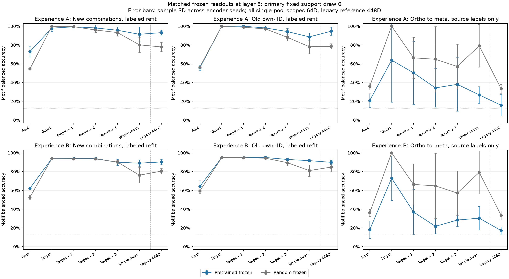
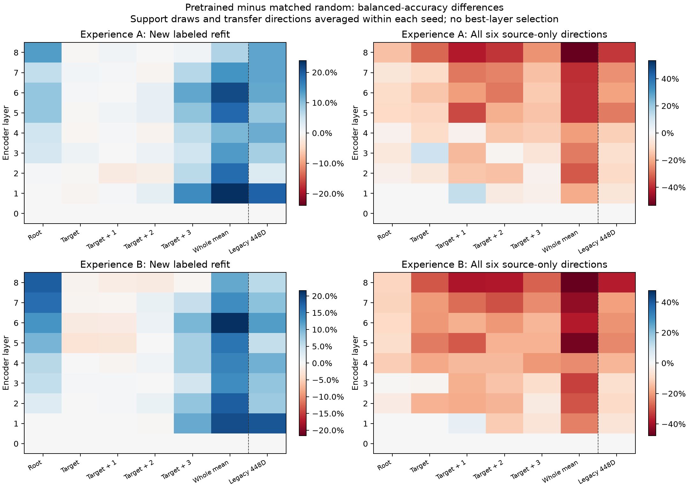

# Frozen readouts across molecular pooling scales

This analysis asks whether pretraining improves information that a matched frozen readout can use, and where that information is accessible. Labeled adaptation and source-position-only transfer answer different questions. All results use fresh standardized multiclass ridge readouts; neither encoder is updated.

## Matched design and statistical unit

The predeclared primary layer is 8, primary support repetition is 0, and ridge alpha is 1.0. Pretrained A and B are each compared with the exact corresponding random initialization seed. The two conditions receive identical support identities, feature standardization estimated from fit data only, and the same fixed regularization and fitting procedure. There is no target-test hyperparameter or layer selection.

3 support repetitions are nested within each encoder seed. Supplemental summaries average repetitions within each seed before computing the mean and sample SD across 3 encoder seeds; they do not count nine repetitions as nine independent models. Paired advantages subtract trained and random scores for each exact seed, repetition, scale, and test condition before averaging. The six-direction summary weights each directed position pair equally within seed. Balanced accuracy averages recalls over the labels present in each test set. The eight-output uniform reference is 12.5%; an empirical random-encoder score is not a theoretical chance level.

## Primary fixed-support comparison

Only support repetition 0 and layer 8 appear in the following tables. Values are mean +/- sample SD across encoder seeds. The adaptation table uses 32 new plus 32 old labels; the direct table fits 32 examples per motif (256 labels) at the source position and uses zero target-position labels. Their label budgets and fit distributions differ, so the gap between these protocols is descriptive rather than a controlled effect of target labels alone.

### Experience A: labeled refit with replay

| Pooling scope | Pretrained new | Random new | Pretrained old | Random old | Paired new advantage |
| --- | --- | --- | --- | --- | --- |
| Root | 73.0 +/- 5.8% (n=3) | 54.5 +/- 0.2% (n=3) | 55.6 +/- 3.0% (n=3) | 56.5 +/- 0.1% (n=3) | 18.5 +/- 5.9 pp (n=3) |
| Target | 98.0 +/- 3.5% (n=3) | 100.0 +/- 0.0% (n=3) | 100.0 +/- 0.0% (n=3) | 100.0 +/- 0.0% (n=3) | -2.0 +/- 3.5 pp (n=3) |
| Target + 1 | 99.4 +/- 1.0% (n=3) | 99.5 +/- 0.6% (n=3) | 100.0 +/- 0.0% (n=3) | 99.0 +/- 1.8% (n=3) | -0.1 +/- 1.4 pp (n=3) |
| Target + 2 | 98.2 +/- 3.1% (n=3) | 96.0 +/- 2.7% (n=3) | 98.2 +/- 1.9% (n=3) | 97.1 +/- 2.0% (n=3) | 2.2 +/- 5.4 pp (n=3) |
| Target + 3 | 95.7 +/- 3.8% (n=3) | 93.2 +/- 3.7% (n=3) | 94.3 +/- 3.3% (n=3) | 88.1 +/- 3.7% (n=3) | 2.5 +/- 3.2 pp (n=3) |
| Whole mean | 91.4 +/- 7.9% (n=3) | 80.2 +/- 8.1% (n=3) | 88.7 +/- 4.1% (n=3) | 78.2 +/- 7.4% (n=3) | 11.3 +/- 3.2 pp (n=3) |
| Legacy 448D | 93.2 +/- 2.6% (n=3) | 77.9 +/- 5.0% (n=3) | 94.7 +/- 4.3% (n=3) | 78.6 +/- 2.8% (n=3) | 15.2 +/- 3.3 pp (n=3) |

### Experience A: ortho-to-meta source-only transfer

| Pooling scope | Pretrained all | Random all | Paired all advantage | Pretrained common OOD | Random common OOD |
| --- | --- | --- | --- | --- | --- |
| Root | 20.8 +/- 7.2% (n=3) | 36.0 +/- 3.7% (n=3) | -15.2 +/- 10.5 pp (n=3) | 11.1 +/- 19.2% (n=3) | 25.3 +/- 7.3% (n=3) |
| Target | 63.8 +/- 44.7% (n=3) | 100.0 +/- 0.0% (n=3) | -36.2 +/- 44.7 pp (n=3) | 60.6 +/- 53.1% (n=3) | 100.0 +/- 0.0% (n=3) |
| Target + 1 | 50.3 +/- 33.4% (n=3) | 66.3 +/- 21.9% (n=3) | -16.0 +/- 55.3 pp (n=3) | 44.8 +/- 50.8% (n=3) | 37.4 +/- 36.5% (n=3) |
| Target + 2 | 34.3 +/- 20.5% (n=3) | 64.8 +/- 34.8% (n=3) | -30.5 +/- 16.0 pp (n=3) | 5.5 +/- 9.6% (n=3) | 64.4 +/- 55.8% (n=3) |
| Target + 3 | 38.1 +/- 28.5% (n=3) | 57.1 +/- 23.7% (n=3) | -19.0 +/- 36.2 pp (n=3) | 18.8 +/- 32.6% (n=3) | 33.5 +/- 40.8% (n=3) |
| Whole mean | 26.8 +/- 8.8% (n=3) | 79.1 +/- 22.8% (n=3) | -52.3 +/- 15.8 pp (n=3) | 12.1 +/- 11.0% (n=3) | 77.3 +/- 31.5% (n=3) |
| Legacy 448D | 15.8 +/- 11.4% (n=3) | 33.4 +/- 4.7% (n=3) | -17.6 +/- 14.2 pp (n=3) | 18.2 +/- 12.5% (n=3) | 23.6 +/- 28.9% (n=3) |

### Experience B: labeled refit with replay

| Pooling scope | Pretrained new | Random new | Pretrained old | Random old | Paired new advantage |
| --- | --- | --- | --- | --- | --- |
| Root | 62.1 +/- 0.5% (n=3) | 52.5 +/- 2.0% (n=3) | 64.2 +/- 6.0% (n=3) | 59.3 +/- 2.3% (n=3) | 9.6 +/- 2.3 pp (n=3) |
| Target | 93.9 +/- 0.0% (n=3) | 93.9 +/- 0.0% (n=3) | 94.9 +/- 0.0% (n=3) | 94.9 +/- 0.0% (n=3) | 0.0 +/- 0.0 pp (n=3) |
| Target + 1 | 93.9 +/- 0.0% (n=3) | 93.6 +/- 0.5% (n=3) | 94.9 +/- 0.0% (n=3) | 94.7 +/- 0.4% (n=3) | 0.3 +/- 0.5 pp (n=3) |
| Target + 2 | 93.9 +/- 0.0% (n=3) | 93.5 +/- 0.6% (n=3) | 95.0 +/- 0.4% (n=3) | 94.3 +/- 0.6% (n=3) | 0.3 +/- 0.6 pp (n=3) |
| Target + 3 | 89.9 +/- 3.2% (n=3) | 90.1 +/- 1.8% (n=3) | 92.9 +/- 1.7% (n=3) | 89.5 +/- 3.1% (n=3) | -0.2 +/- 3.8 pp (n=3) |
| Whole mean | 89.0 +/- 3.7% (n=3) | 76.2 +/- 8.1% (n=3) | 91.7 +/- 1.3% (n=3) | 81.1 +/- 6.1% (n=3) | 12.8 +/- 4.5 pp (n=3) |
| Legacy 448D | 90.3 +/- 2.8% (n=3) | 80.5 +/- 2.8% (n=3) | 89.9 +/- 2.2% (n=3) | 84.8 +/- 5.0% (n=3) | 9.8 +/- 3.7 pp (n=3) |

### Experience B: ortho-to-meta source-only transfer

| Pooling scope | Pretrained all | Random all | Paired all advantage | Pretrained common OOD | Random common OOD |
| --- | --- | --- | --- | --- | --- |
| Root | 18.1 +/- 9.4% (n=3) | 36.0 +/- 3.7% (n=3) | -18.0 +/- 10.0 pp (n=3) | 0.0 +/- 0.0% (n=3) | 25.3 +/- 7.3% (n=3) |
| Target | 73.0 +/- 23.6% (n=3) | 100.0 +/- 0.0% (n=3) | -27.0 +/- 23.6 pp (n=3) | 72.3 +/- 47.9% (n=3) | 100.0 +/- 0.0% (n=3) |
| Target + 1 | 36.9 +/- 24.1% (n=3) | 66.3 +/- 21.9% (n=3) | -29.4 +/- 17.5 pp (n=3) | 55.6 +/- 50.9% (n=3) | 37.4 +/- 36.5% (n=3) |
| Target + 2 | 21.7 +/- 8.0% (n=3) | 64.8 +/- 34.8% (n=3) | -43.1 +/- 40.4 pp (n=3) | 13.1 +/- 18.7% (n=3) | 64.4 +/- 55.8% (n=3) |
| Target + 3 | 28.4 +/- 6.6% (n=3) | 57.1 +/- 23.7% (n=3) | -28.7 +/- 23.2 pp (n=3) | 32.8 +/- 19.4% (n=3) | 33.5 +/- 40.8% (n=3) |
| Whole mean | 30.4 +/- 12.6% (n=3) | 79.1 +/- 22.8% (n=3) | -48.8 +/- 33.0 pp (n=3) | 26.6 +/- 38.6% (n=3) | 77.3 +/- 31.5% (n=3) |
| Legacy 448D | 17.2 +/- 3.9% (n=3) | 33.4 +/- 4.7% (n=3) | -16.2 +/- 8.0 pp (n=3) | 19.6 +/- 13.0% (n=3) | 23.6 +/- 28.9% (n=3) |

## Robustness across support draws and directions

The following layer-fixed summary averages all support repetitions within seed. Direct transfer additionally averages all six ordered position pairs within seed. Every individual pair, support draw, encoder seed, layer, ordinary accuracy, and balanced accuracy remains available in the source CSVs and derived seed tables.

| Experience | Pooling scope | Refit paired new advantage | Direct pretrained | Direct random | Direct paired advantage |
| --- | --- | --- | --- | --- | --- |
| A | Root | 13.3 +/- 4.5 pp (n=3) | 20.3 +/- 2.5% (n=3) | 35.9 +/- 2.4% (n=3) | -15.6 +/- 3.7 pp (n=3) |
| A | Target | -0.3 +/- 0.5 pp (n=3) | 69.5 +/- 16.4% (n=3) | 100.0 +/- 0.0% (n=3) | -30.5 +/- 16.4 pp (n=3) |
| A | Target + 1 | 0.8 +/- 0.7 pp (n=3) | 40.7 +/- 12.8% (n=3) | 83.2 +/- 7.7% (n=3) | -42.4 +/- 19.8 pp (n=3) |
| A | Target + 2 | -0.0 +/- 2.2 pp (n=3) | 25.6 +/- 3.8% (n=3) | 63.9 +/- 12.6% (n=3) | -38.3 +/- 8.8 pp (n=3) |
| A | Target + 3 | 0.8 +/- 2.0 pp (n=3) | 27.4 +/- 11.2% (n=3) | 51.2 +/- 18.6% (n=3) | -23.9 +/- 20.3 pp (n=3) |
| A | Whole mean | 7.1 +/- 4.2 pp (n=3) | 27.3 +/- 6.3% (n=3) | 80.7 +/- 16.2% (n=3) | -53.4 +/- 10.0 pp (n=3) |
| A | Legacy 448D | 12.7 +/- 0.6 pp (n=3) | 19.5 +/- 4.1% (n=3) | 57.3 +/- 7.9% (n=3) | -37.8 +/- 11.2 pp (n=3) |
| B | Root | 17.8 +/- 2.5 pp (n=3) | 25.7 +/- 7.2% (n=3) | 35.9 +/- 2.4% (n=3) | -10.2 +/- 9.5 pp (n=3) |
| B | Target | -0.7 +/- 1.1 pp (n=3) | 70.3 +/- 13.1% (n=3) | 100.0 +/- 0.0% (n=3) | -29.7 +/- 13.1 pp (n=3) |
| B | Target + 1 | -1.5 +/- 0.4 pp (n=3) | 44.8 +/- 12.9% (n=3) | 83.2 +/- 7.7% (n=3) | -38.4 +/- 13.1 pp (n=3) |
| B | Target + 2 | -1.9 +/- 0.4 pp (n=3) | 25.9 +/- 3.4% (n=3) | 63.9 +/- 12.6% (n=3) | -38.0 +/- 11.7 pp (n=3) |
| B | Target + 3 | -0.4 +/- 3.5 pp (n=3) | 23.3 +/- 4.5% (n=3) | 51.2 +/- 18.6% (n=3) | -27.9 +/- 22.7 pp (n=3) |
| B | Whole mean | 11.0 +/- 0.8 pp (n=3) | 33.1 +/- 3.0% (n=3) | 80.7 +/- 16.2% (n=3) | -47.6 +/- 19.2 pp (n=3) |
| B | Legacy 448D | 5.8 +/- 1.9 pp (n=3) | 19.8 +/- 2.5% (n=3) | 57.3 +/- 7.9% (n=3) | -37.5 +/- 10.4 pp (n=3) |

## What spatial scope does and does not establish

Root, target-substituent mean, target plus one/two/three graph-neighborhood shells, and whole-graph mean each have 64 features. The legacy graph readout has 448 features: whole-graph mean, sum divided by square-root atom count, target root, and four marked-query node sums. Its feature width and query-specific channels differ, so it is a separate reference rather than another equal-width pooling scope.

Target atom memberships are oracle metadata applied only after encoding. They are not supplied as encoder inputs and do not test whether a model can discover a substituent boundary. All node states come from the original full-molecule encoder. In particular, layer-eight selected nodes already aggregate messages from up to eight graph hops. A small pooling set is therefore not a strictly local input: remote context can remain accessible. The saved locality.csv quantifies pooling sizes and receptive-field reach; small-pool success establishes accessible information at those nodes, not independence from distant molecular context. Even layer-zero degree and hydrogen features retain boundary chemistry. Receptive reach is an architectural upper bound, not evidence that every reachable atom affects the prediction.

Architectural receptive support at layer 8, over the saved molecular identities (mean atom count [minimum, maximum]):

| Pooling scope | Pooled atoms | Reachable input atoms | Mean molecule fraction reached | Full graph reached |
| --- | --- | --- | --- | --- |
| Root | 1.0 [1, 1] | 20.8 [19, 23] | 99.9% | 98.7% |
| Target | 9.0 [9, 9] | 20.8 [19, 23] | 99.9% | 98.7% |
| Target + 1 | 10.0 [10, 10] | 20.8 [19, 23] | 100.0% | 100.0% |
| Target + 2 | 12.0 [12, 12] | 20.8 [19, 23] | 100.0% | 100.0% |
| Target + 3 | 14.8 [14, 16] | 20.8 [19, 23] | 100.0% | 100.0% |
| Whole mean | 20.8 [19, 23] | 20.8 [19, 23] | 100.0% | 100.0% |
| Legacy 448D | 20.8 [19, 23] | 20.8 [19, 23] | 100.0% | 100.0% |

Source-only transfer fits labels at one position and evaluates different molecule identities at another. It is not the inherited chemical task head's zero-shot prediction, and success would not alone prove generalization to a novel motif type. Labeled refit uses new-combination labels, so high accuracy there establishes adaptation/readability under that support distribution. A pretrained advantage is conditional on its prior labels and training compute. Negative linear readout results cannot rule out information accessible through other pooling operations or nonlinear decoders.

## Records

Reporting preserves recorded measurements and source archives. The machine-readable report_summary.json contains primary and repeat-averaged results separately, seed_metrics.csv retains encoder-seed means, and paired_seed_deltas.csv retains exact matched contrasts. adaptation.csv and direct_transfer.csv contain every support-level result, including both accuracy definitions and prediction references. No best seed, support draw, pooling scope, or layer was selected for the primary comparison.
