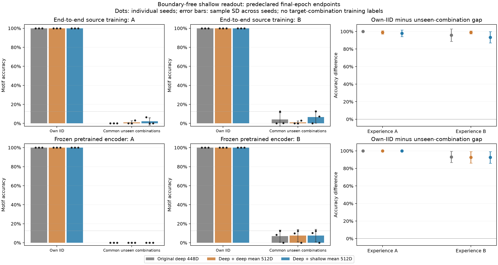
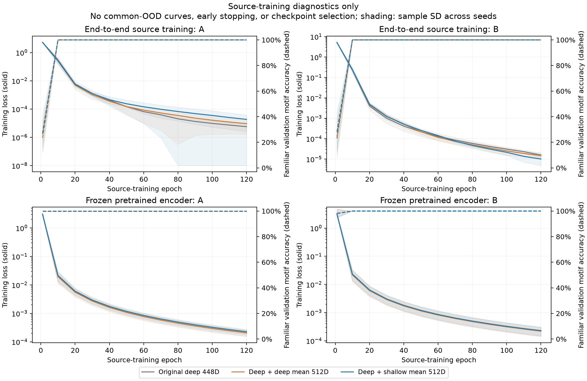

# Boundary-free shallow-feature readout intervention

This experiment tests whether exposing shallow whole-graph features to the original task heads improves predictions on unseen motif-position combinations. All training labels come from the original hard_v2 source training identities. No target-combination labels, adaptation supports, or target-fragment boundaries are added.

## Design and primary contrast

The primary regime is end-to-end source training. Its primary endpoint is ordinary motif accuracy on the common unseen-combination test set, and the primary contrast is shallow skip minus the parameter-matched deep control, paired by exact initialization seed. The original 448D deep readout is a separate baseline. The matched variants both have 512 input features and identical trainable parameter counts: one appends the whole-graph mean after message layer one; the other appends the final-layer whole-graph mean. The latter is a deterministic duplicate of a block already present in the 448D vector, so it controls added head width and reparameterization without adding new information.

All runs use 120 predeclared epochs, the same source minibatch order within seed, AdamW, the original three-task loss, and the original training hyperparameters. Added first-layer head columns start at zero; the inherited 448D columns and other head parameters share the exact archived random initialization. The common OOD set is evaluated only after the fixed final epoch; there is no OOD checkpoint, hyperparameter, or best-seed selection.

End-to-end augmented models start from the archived random encoder and learn encoder plus heads. The original deep end-to-end baselines reuse the exact completed hard_v2 checkpoints and source-training histories; their final predictions are recomputed. Frozen-readout runs keep the corresponding pretrained A/B encoder fixed, reset the heads to that seed's archived random head values, and train only the heads on cached full-molecule features. They do not continue the inherited trained classifier. These regimes have different encoder histories and are interpreted separately. Identical update budgets and matched parameters do not imply identical compute or optimization.

Values below are mean +/- sample SD across 3 initialization seeds, with A and B reported separately. A and B are not pooled into six independent replicates. Paired differences subtract variants within each seed before computing their SD; they are descriptive contrasts, not significance tests. Eight-output uniform random guessing is 12.5% for the motif task.

## Final-epoch intact predictions

### End-to-end source training

| Experience | Readout | Own-IID motif | Unseen motif | Unseen position | Unseen distance | Unseen distance MAE | Unseen joint |
| --- | --- | --- | --- | --- | --- | --- | --- |
| A | Original deep 448D | 100.0 +/- 0.0% | 0.0 +/- 0.0% | 100.0 +/- 0.0% | 86.8 +/- 15.2% | 0.1 +/- 0.2 bonds | 0.0 +/- 0.0% |
| A | Deep + deep mean 512D | 100.0 +/- 0.0% | 1.1 +/- 1.8% | 99.3 +/- 1.2% | 85.0 +/- 9.1% | 0.1 +/- 0.1 bonds | 0.2 +/- 0.4% |
| A | Deep + shallow mean 512D | 100.0 +/- 0.0% | 2.2 +/- 3.8% | 100.0 +/- 0.0% | 90.9 +/- 4.6% | 0.1 +/- 0.0 bonds | 2.2 +/- 3.8% |
| B | Original deep 448D | 100.0 +/- 0.0% | 4.2 +/- 7.1% | 100.0 +/- 0.0% | 75.9 +/- 18.1% | 0.2 +/- 0.2 bonds | 1.6 +/- 2.5% |
| B | Deep + deep mean 512D | 100.0 +/- 0.0% | 1.0 +/- 1.7% | 100.0 +/- 0.0% | 79.3 +/- 25.9% | 0.2 +/- 0.3 bonds | 0.0 +/- 0.0% |
| B | Deep + shallow mean 512D | 100.0 +/- 0.0% | 6.6 +/- 6.3% | 100.0 +/- 0.0% | 77.1 +/- 25.6% | 0.2 +/- 0.3 bonds | 2.8 +/- 3.9% |

### Frozen pretrained encoder

| Experience | Readout | Own-IID motif | Unseen motif | Unseen position | Unseen distance | Unseen distance MAE | Unseen joint |
| --- | --- | --- | --- | --- | --- | --- | --- |
| A | Original deep 448D | 100.0 +/- 0.0% | 0.0 +/- 0.0% | 100.0 +/- 0.0% | 95.1 +/- 6.6% | 0.0 +/- 0.1 bonds | 0.0 +/- 0.0% |
| A | Deep + deep mean 512D | 100.0 +/- 0.0% | 0.0 +/- 0.0% | 100.0 +/- 0.0% | 95.4 +/- 6.1% | 0.0 +/- 0.1 bonds | 0.0 +/- 0.0% |
| A | Deep + shallow mean 512D | 100.0 +/- 0.0% | 0.0 +/- 0.0% | 100.0 +/- 0.0% | 95.1 +/- 6.6% | 0.0 +/- 0.1 bonds | 0.0 +/- 0.0% |
| B | Original deep 448D | 100.0 +/- 0.0% | 6.9 +/- 6.3% | 100.0 +/- 0.0% | 95.1 +/- 4.3% | 0.0 +/- 0.0 bonds | 5.9 +/- 5.2% |
| B | Deep + deep mean 512D | 100.0 +/- 0.0% | 7.4 +/- 6.6% | 100.0 +/- 0.0% | 95.3 +/- 4.1% | 0.0 +/- 0.0 bonds | 6.1 +/- 5.3% |
| B | Deep + shallow mean 512D | 100.0 +/- 0.0% | 7.5 +/- 6.6% | 100.0 +/- 0.0% | 95.0 +/- 4.1% | 0.0 +/- 0.0 bonds | 6.1 +/- 5.4% |

## Paired primary and secondary task contrasts

All cells below compare the intact shallow skip with the intact 512D deep control. Differences are percentage points; positive accuracy differences favor the shallow skip. Balanced accuracy averages recall over test labels, and is reported alongside the predeclared ordinary-accuracy endpoint.

| Regime | Experience | Own-IID motif | Unseen motif (primary) | Unseen motif balanced | Unseen position | Unseen distance | Unseen joint |
| --- | --- | --- | --- | --- | --- | --- | --- |
| End-to-end source training | A | 0.0 +/- 0.0 pp | 1.1 +/- 5.0 pp | 1.0 +/- 5.2 pp | 0.7 +/- 1.2 pp | 5.9 +/- 13.6 pp | 2.0 +/- 4.0 pp |
| End-to-end source training | B | 0.0 +/- 0.0 pp | 5.6 +/- 6.4 pp | 5.7 +/- 6.5 pp | 0.0 +/- 0.0 pp | -2.2 +/- 8.2 pp | 2.8 +/- 3.9 pp |
| Frozen pretrained encoder | A | 0.0 +/- 0.0 pp | 0.0 +/- 0.0 pp | 0.0 +/- 0.0 pp | 0.0 +/- 0.0 pp | -0.3 +/- 0.5 pp | 0.0 +/- 0.0 pp |
| Frozen pretrained encoder | B | 0.0 +/- 0.0 pp | 0.1 +/- 0.1 pp | 0.1 +/- 0.1 pp | 0.0 +/- 0.0 pp | -0.3 +/- 0.8 pp | 0.0 +/- 0.7 pp |

## Secondary appended-branch interventions

After training, the appended branch is either set to zero or permuted across test molecules while the encoder, inherited deep vector, and heads stay fixed. These interventions test functional compatibility and reliance of the fitted model on this branch. They do not measure information destruction or provide an additive causal decomposition: replacement features can be incompatible with the classifier and training distribution.

| Regime | Experience | Readout | Intact unseen motif | Zero branch | Permuted branch |
| --- | --- | --- | --- | --- | --- |
| End-to-end source training | A | Deep + deep mean 512D | 1.1 +/- 1.8% | 1.4 +/- 1.8% | 1.2 +/- 1.7% |
| End-to-end source training | A | Deep + shallow mean 512D | 2.2 +/- 3.8% | 2.3 +/- 4.0% | 2.2 +/- 3.8% |
| End-to-end source training | B | Deep + deep mean 512D | 1.0 +/- 1.7% | 1.2 +/- 1.7% | 1.9 +/- 2.5% |
| End-to-end source training | B | Deep + shallow mean 512D | 6.6 +/- 6.3% | 6.8 +/- 7.0% | 6.6 +/- 6.3% |
| Frozen pretrained encoder | A | Deep + deep mean 512D | 0.0 +/- 0.0% | 0.0 +/- 0.0% | 0.0 +/- 0.0% |
| Frozen pretrained encoder | A | Deep + shallow mean 512D | 0.0 +/- 0.0% | 0.0 +/- 0.0% | 0.0 +/- 0.0% |
| Frozen pretrained encoder | B | Deep + deep mean 512D | 7.4 +/- 6.6% | 7.6 +/- 6.7% | 7.7 +/- 6.7% |
| Frozen pretrained encoder | B | Deep + shallow mean 512D | 7.5 +/- 6.6% | 7.6 +/- 6.7% | 7.5 +/- 6.6% |

## Parameters and source-training diagnostics

| Regime | Readout | Input features | Total parameters | Trainable parameters |
| --- | --- | --- | --- | --- |
| End-to-end source training | Original deep 448D | 448 | 189531 | 189531 |
| End-to-end source training | Deep + deep mean 512D | 512 | 201819 | 201819 |
| End-to-end source training | Deep + shallow mean 512D | 512 | 201819 | 201819 |
| Frozen pretrained encoder | Original deep 448D | 448 | 189531 | 87963 |
| Frozen pretrained encoder | Deep + deep mean 512D | 512 | 201819 | 100251 |
| Frozen pretrained encoder | Deep + shallow mean 512D | 512 | 201819 | 100251 |

Training curves display source training loss and familiar validation motif accuracy only. Familiar validation position and distance scores remain in the recorded histories. No test trajectory was used to select the endpoint.

## Interpretation limits and preserved records

The added shallow pool averages all real atoms and never receives target_fragment_indices or an oracle membership mask. It retains the original atom/query features supplied to every variant, so it is boundary-free rather than query-free. Whole-graph shallow pooling can mix the target, ring, anchor, and distractor; it does not isolate a context-independent substituent code. A benefit in the frozen regime would implicate access through the readout on fixed encoder states; an end-to-end benefit can additionally involve representation and optimization changes. A null result would show that this particular shallow mean and training rule are insufficient, not that all useful shallow information is absent. Linear probe readability, labeled adaptation, and zero-target-label task prediction remain distinct measurements.

behavior.csv preserves every split, task metric, seed, and intervention. seed_metrics.csv retains individual endpoints and each intact model's own-IID-minus-common-OOD motif gap; paired_seed_deltas.csv retains exact-seed contrasts. report_summary.json records all task summaries, gaps, paired contrasts, and inventory provenance. Both IID sets, balanced task accuracies, and distance MAE are available in those complete machine-readable records even when the compact tables focus on own IID and common OOD. The report generator preserves measured inputs and prior archived experiments.
