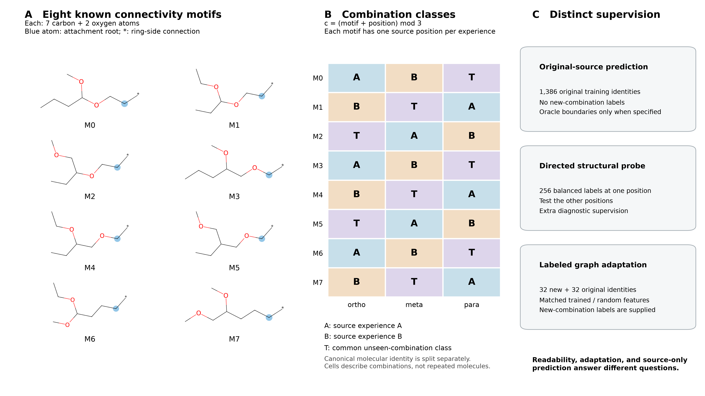

# Separating Structural Readability, Adaptation, and Compositional Generalization in a Controlled Molecular Graph Task

**Working manuscript, 1 November 2026.** This draft summarizes completed records through v7, executed from source commit `b20fa80`, and retains the v6 archive at `19916b8`. Numerical execution qualifications are reported in Supplement S11. Author information and submission declarations have not been supplied. Numerical claims are indexed in [CLAIMS.csv](CLAIMS.csv); implementation and supervision details are in [SUPPLEMENT.md](SUPPLEMENT.md).

## Abstract

Structural information that can be decoded from a molecular graph representation may fail to support prediction on unseen combinations. We examine this separation in 6,912 controlled molecular graphs containing eight composition-matched substituents at three ring positions. Source training binds each motif to one position. Small message-passing models attain 100% familiar accuracy but fail on held-out pairings. First-layer local decoding succeeds for trained and random encoders. Supplying target membership gives 100% source-only unseen accuracy, whereas the original shallow-path classifiers score 2.2% and 6.6% in two training experiences. Standardized shallow whole-graph ridge readouts recover 37.4% and 64.2% using the same source motif labels. Matched full-input ridge fits score 0.0% and 8.4%, although their inputs contain the identical shallow vectors. Both scopes retain 100% familiar accuracy. A saved-state certificate shows that the shallow rule is feasible inside the full ridge model with unchanged coefficient penalty; the full fitter instead selects a lower-source-objective rule that generalizes poorly. Adding a shallow mean to the original classifier does not stably resolve failure. Separately, trained features benefit adaptation when new-combination labels are supplied. The results distinguish diagnostic readability, labeled adaptation, and source-only generalization. Localization and fitted rules are consequential under this controlled binding, while complete attribution of earlier head-replacement gains and relevance to chemical-property prediction remain unresolved.

## Introduction

Molecular graph prediction combines atoms, local environments, and relationships between structures. Message-passing models transform neighboring atom states and aggregate them for prediction, including on quantum-chemical benchmarks. [Gilmer et al., 2017](https://proceedings.mlr.press/v70/gilmer17a.html) A model can nevertheless fail when a known fragment appears in a new context. Understanding that failure requires more than identifying recognizable fragments in a representation.

Three questions need separate evaluation: whether a diagnostic recovers a structural label; whether prior training benefits adaptation with new labels; and whether the original predictor handles unseen combinations using only source labels. Their supervision, feature selection, and fitting conditions differ, so success on one does not establish success on the others.

Prior work already provides reasons to expect these distinctions. Molecular graph probing has shown that random encoders can expose useful structural features and sometimes match trained encoders on diagnostic properties. A high probe score therefore requires an initialization control before it can be attributed to training. [Akhondzadeh et al., 2023](https://proceedings.mlr.press/v206/akhondzadeh23a.html) More generally, experiments on linguistic models have demonstrated that a property can be decodable even when it is unnecessary for the original task. [Ravichander et al., 2021](https://aclanthology.org/2021.eacl-main.295/) These findings motivate separate tests of readability and prediction behavior.

The distinction also matters when a model relies on correlations that do not transfer. Deep Feature Reweighting demonstrated that refitting a final classifier can improve robustness while leaving a trained representation fixed. Its group-balanced reweighting data and diagnostic protocols are central to interpreting that recovery. [Kirichenko et al., 2023](https://arxiv.org/abs/2204.02937) Recovering performance by fitting another head is thus an established possibility. The question here is more specific: at which spatial scope is molecular structure accessible, what supervision makes it accessible to a classifier, and does a boundary-free route from shallow features improve the original predictor?

We study these questions using computed two-dimensional structural labels, rather than experimental chemical properties. The target motifs share elemental composition and ordinary atom-feature multisets, which removes simple atom-count explanations. Molecular background, attachment position, and path queries vary. We deliberately impose a strong training association: each motif occurs at only one ring position within a training experience, although every motif and every position occurs somewhere in training. Held-out combinations can therefore distinguish a transferable structural rule from rules that depend on the training binding.

We compare diagnostic cross-position decoding, newly labeled adaptation, and source-only prediction. Matched random encoders identify abilities that precede training; matched pools test supplied localization; and a shallow-path intervention tests access to earlier features. A final crossed-readout panel narrows the role of fitted rules while distinguishing conditional recovery from a uniquely identified mechanism.

## Methods

### Controlled structures and molecular identity partitions

The benchmark contains 6,912 unique canonical molecular identities. Eight nine-heavy-atom ether motifs each contain seven carbons and two oxygens. Their ordinary atom-feature multisets, including degree and hydrogen attributes, are matched, while their connectivity differs. The marked attachment roots also share the same ordinary attributes. Each motif is combined with three relative ring positions, eight reference substituents, three reference-side spacer lengths, three aromatic scaffolds, and four distractors. The scaffolds are benzene and two pyridine variants. These factors produce contextual variation around a fixed set of known motif topologies.

**Figure 1.** Controlled structures and evaluation protocols. **A:** Eight known target connectivities; blue marks the attachment root, and `*` denotes the ring-side connection rather than an additional target heavy atom. **B:** Motif–position cells define A/B source experiences and a shared unseen combination class, T. Canonical molecular identity is partitioned separately, so cells describe combination types, not repeated molecules. **C:** Original-source prediction, directed probing, and labeled adaptation have different supervision budgets. Known target boundaries are extra information in explicitly designated oracle-pooling fits; ordinary source training receives no boundary mask.

Canonical identity determines the split before model training. Candidate training, validation, adaptation-reserve, and test partitions use fixed hash intervals with probabilities 0.6, 0.1, 0.1, and 0.2. Alternative SMILES traversals cannot create independent train and test entries. For motif index \(m\) and position index \(p\), the combination class is \(c=(m+p)\bmod 3\). Experience A trains on class 0; Experience B trains on class 1; class 2 supplies the common unseen-combination test. Training counts are matched motif by motif, yielding 1,386 molecules per experience. Familiar test sets contain 462 and 472 molecules; the common unseen test contains 443. A separate reserve supplies new-combination adaptation labels.

Each experience contains all eight motifs and all three positions, but only one position per motif. Position alone cannot identify all eight motifs. Nevertheless, a structural rule that generalizes across position and a rule that depends on the observed motif–position bindings can both fit the source labels. The experiment is designed to expose this ambiguity, not to make familiar accuracy a sufficient test of structural learning.

### Encoders and original training

The base model has eight message-passing layers of width 64 and 189,531 parameters. Each layer sums neighboring states, applies a shared residual update, normalizes each node across its features, and applies a rectifier. Atom inputs contain ordinary chemical attributes and five query markers identifying the relevant attachment and path atoms. No target-fragment membership mask enters the encoder. Bond adjacency is used without a separate learned bond-type channel.

The original 448-dimensional graph/query representation concatenates two global pools with the target-root state and four marked-query sums. Separate two-layer heads predict motif identity, relative ring position, and shortest-path bond count between marked atoms. Models train jointly on these three computed labels for 120 epochs with the same architecture and hyperparameters across experiences. Three initialization seeds are retained. The term trained encoder throughout refers to this structural-task training, rather than large-scale molecular-property pretraining.

### Three distinct supervision protocols

The comparisons use the following label and localization budgets.

| Protocol | Labels used to fit the evaluated readout | Extra localization | What it measures |
| --- | --- | --- | --- |
| Original source task or source-only refit | The original 1,386 source molecules; no held-out combination labels | None for whole-graph features; supplied membership for oracle pooling | Prediction of unseen combinations from the original label distribution |
| Directed cross-position diagnostic | 256 balanced labels from one source position | Specified post-encoding pooling mask | Readability at a different position under extra diagnostic supervision |
| Labeled adaptation with replay | 32 new-combination molecules and 32 old source molecules | None for the graph/query reference | Fixed-support adaptation of trained versus random frozen features |

Cross-position supports can contain combinations excluded from encoder training. They contain no labels from the target position of that directed fit, but they are additional supervision. Oracle pools use known motif membership after encoding the full molecular input. Neither the directed diagnostic nor the oracle localizer is equivalent to the original predictor operating without extra information.

Diagnostic linear classifiers use support-only feature standardization, an unpenalized intercept, one-hot targets, and ridge regularization fixed at one. Source-only nonlinear readouts use a fresh 64-to-64-to-8 rectified classifier with the same initialization and minibatch orders across pooling scopes. Both receive only motif labels. They are distinct from the original joint three-task classifier. We compare the actual layer-1 whole-graph mean appended in the shallow-path experiment with an equal-width mean over the nine annotated target atoms. Means exclude padding.

### Shallow-path and output interventions

The shallow-path model appends the layer-1 whole-graph mean to the original deep graph/query vector. Its parameter-matched control instead appends the final-layer mean, duplicating information already available in the original vector. Both have 512 input features and 201,819 parameters. Added head columns start at zero, and initialization, source identities, minibatch orders, and 120-epoch budgets are matched. We separately train encoder plus heads from initialization and reset heads on a fixed trained encoder. No target-fragment boundary or new-combination label is added.

After fitting, the appended branch is either zeroed or permuted across molecules, with deep coordinates and final heads fixed. We measure class changes and the correct-class logit margin, \(z_y-\max_{k\ne y}z_k\), as well as centered-logit distances. These replacements measure output sensitivity of a fixed model; they may produce feature pairs outside its fitted distribution and do not yield an additive causal decomposition.

A final frozen-readout panel crosses full versus shallow-only inputs, raw versus training-standardized features, and motif-only versus joint loss, with identical 512-input heads and original source labels. All eight MLP cells and four separate ridge cells are fitted on every trained and random source-label case. The complete protocol and historical initialization are specified in Supplement S9.

### Endpoints and uncertainty

Source-only results use ordinary motif accuracy on the common unseen test, with familiar accuracy as a guard. Directed probes and the matched adaptation analysis use balanced accuracy, defined as mean class recall. We label these definitions explicitly rather than treating their values as interchangeable. All reported deviations are sample standard deviations across three encoder seeds. Support draws and six ordered position directions are averaged within seed before aggregation; A and B remain separate. Paired contrasts subtract matched conditions within seed. They are descriptive and are not significance tests. Uniform guessing among eight classes has expected accuracy 12.5%, separate from an empirical random-encoder baseline.

## Results

### Familiar accuracy conceals failure on unseen motif–position combinations

The original deep models achieve 100% familiar accuracy on all three structural tasks. Common unseen-combination motif accuracy is 0.0% ± 0.0% for A and 4.2% ± 7.1% for B, although position accuracy remains 100%. These models can identify the queried relative position while assigning the target motif incorrectly under a different binding.

A position-only maximum-probability baseline scores zero on the unseen test but only 35.9% and 37.9% on familiar tests. Most model errors choose labels supported at that position in training. This supports binding dependence without identifying a pure position-only classifier.

### Local structural readability exists before task training

At layer one, the known-target mean supports 100% balanced cross-position decoding for trained and matched random encoders across the recorded directions and support draws. At layer eight, support- and direction-averaged target decoding falls to 69.5% ± 16.4% for A and 70.3% ± 13.1% for B, while the random reference remains approximately 99.98%. Thus training reduces deep cross-position linear readability in this setup. This is a statement about a specified pool, decoder, and label protocol; it does not establish erasure of structural information.

Shallow success has an architectural component. Shared local aggregation maps matching attributed neighborhoods consistently under the same weights, including random weights, before differences outside their receptive support can affect them. This follows from the neighborhood-aggregation framework studied by [Xu et al., 2019](https://arxiv.org/abs/1810.00826). Consistency does not guarantee that different motifs will be linearly separable. The latter is an empirical result of this benchmark. Query markers and ordinary boundary attributes must also be included when assessing neighborhood equivalence.

### Training benefits labeled graph adaptation under a different protocol

Matched frozen graph/query readouts provide a complementary result. With 32 labeled new-combination molecules and replay of 32 old labels, trained features outperform same-seed random features on new-test balanced accuracy. After averaging support draws within each seed, the paired advantages are 12.7 ± 0.6 percentage points for A and 5.8 ± 1.9 for B. These comparisons use identical supports, standardization, regularization, and fitting procedures.

Training therefore has a useful consequence despite the weak original unseen-combination predictor and the strong random local diagnostic. The advantage is conditional on new labels and prior training compute. It does not show that the original head would select a transferable rule without those labels, nor does it establish a general reduction in sample complexity from a single support budget.

### Exposing shallow whole-graph means does not give a stable rescue

The shallow-path intervention retains 100% familiar motif accuracy. Its common unseen accuracy remains low (Table 1). Relative to the parameter-matched deep control, paired end-to-end gains are 1.1 ± 5.0 percentage points for A and 5.6 ± 6.4 for B. Reset-head fitting on a fixed trained encoder gives zero gain for A and approximately 0.08 percentage points for B. The small absolute accuracies and seed variation do not support a stable resolution of the generalization failure.

**Table 1.** Source-only unseen-combination motif accuracy, mean ± sample SD across three seeds. The two 512-dimensional variants have matched parameter counts. All entries retain 100% own-familiar motif accuracy. See claims C20–C27 in the numerical ledger.

| Encoder fitting | Experience | Original deep | Matched deep control | Shallow path |
| --- | --- | --- | --- | --- |
| End to end | A | 0.0 ± 0.0% | 1.1 ± 1.8% | 2.2 ± 3.8% |
| End to end | B | 4.2 ± 7.1% | 1.0 ± 1.7% | 6.6 ± 6.3% |
| Fixed trained encoder | A | 0.0 ± 0.0% | 0.0 ± 0.0% | 0.0 ± 0.0% |
| Fixed trained encoder | B | 6.9 ± 6.3% | 7.4 ± 6.6% | 7.5 ± 6.6% |

Output diagnostics qualify this negative intervention. Shallow-branch permutation changes logits on every unseen molecule, but changes the motif class only once across 12 fitted models and 443 molecules per model. That event changes one wrong class into another. Across the four experience/regime panels, seed-mean absolute margin changes range from 0.0048 to 0.0069 under permutation and from 0.140 to 0.272 under zeroing, in each head's own logit units. The branch participates in continuous computation, while the recorded permutation has weak effects on decisions. Similar accuracy after zeroing is compatible with training-induced changes in the deep path, but does not identify their mechanism.

### Supplied localization resolves the task under matched source-only readouts

The pooling experiment holds each encoder fixed and uses exactly its original source identities and motif labels. Oracle target pooling attains 100% unseen accuracy for ridge and nonlinear heads on every tested encoder, including random encoders. These results use a supplied nine-atom membership mask. They establish a diagnostic upper bound with explicit localization, rather than a boundary-free molecular prediction method.

Whole-graph means support useful but incomplete recovery (Table 2). For the actual end-to-end shallow-path encoders, ridge accuracy is 37.4% ± 19.5% for A and 64.2% ± 9.6% for B, substantially above the original heads' 2.2% and 6.6%. Own-familiar ridge accuracy remains 100% for those trained encoders. Useful structural information therefore remains accessible after whole-graph averaging under this fitting rule.

**Table 2.** Original-source-label refits on frozen layer-1 features. Entries are ordinary unseen-combination accuracy across three seeds. Every corresponding oracle-target fit achieves 100.0% ± 0.0%. A and B random rows share the same three encoders and are separate source-label fits, not six initializations. See claims C30–C42.

| Encoder source | Experience | Whole-graph ridge | Whole-graph nonlinear head |
| --- | --- | --- | --- |
| End-to-end shallow-path model | A | 37.4 ± 19.5% | 17.6 ± 15.2% |
| End-to-end shallow-path model | B | 64.2 ± 9.6% | 28.4 ± 9.4% |
| Original structural-task model | A | 27.4 ± 8.5% | 18.9 ± 20.0% |
| Original structural-task model | B | 58.6 ± 20.3% | 20.5 ± 17.0% |
| Random initialization | A | 48.9 ± 24.1% | 52.5 ± 11.6% |
| Random initialization | B | 65.1 ± 25.9% | 41.8 ± 18.3% |

The matched oracle-versus-whole contrast implicates localization and pooling under each fixed decoder protocol. The stronger ridge results also make fitting conditions consequential. However, ridge versus nonlinear fitting changes objective, regularization, function class, and optimization. Comparing either new head with the original classifier additionally changes standardization, feature range, and the joint three-task objective. These comparisons cannot assign a separate effect to each factor. The completed random controls also prevent the recovered accuracy from being treated as evidence that task training created shallow structural readability.

### Matched factors isolate a conditional fitted-rule effect

The full readout-factor panel includes 144 MLP and 72 ridge fits, with all encoders frozen. Standardization does not rescue full-input MLP prediction on the end-to-end-source encoders: joint-loss unseen accuracy is 0.0% for A and 3.4% for B. Standardized shallow-only fitting reaches 17.8% and 26.7%, while matched random encoders reach 52.1% and 39.4%. Raw shallow-only MLPs substantially underfit the source task. Their A/B training accuracies are 52.6% and 55.3%, compared with approximately 100% after standardization. Scaling therefore changes fitting success without guaranteeing transfer. All cells, familiar guards, conditional contrasts, and seed values appear in Supplement S9 and claims C100–C112.

The standardized ridge comparison gives a cleaner input-scope result (Table 3). Removing deep coordinates improves unseen prediction for the end-to-end-source encoders while both fits retain 100% training and familiar accuracy. The shallow vector remains an unchanged block of the full input. A post-run, no-refit certificate verifies that zero-padding a shallow coefficient vector reproduces its predictions with the same coefficient penalty inside the full model. Nevertheless, the fitted full-vector ridge solution has a lower source penalized objective. The poorer full-vector prediction therefore reflects the mapping selected by this fitting rule, rather than absence of access to the shallow inputs. This comparison does not identify which semantic shortcut was selected.

**Table 3.** Standardized source-only ridge on end-to-end-source encoders. Accuracy and paired gains are mean ± sample SD across three seeds. Both trained scopes have 100% own-familiar accuracy. The random reference shows that shallow recovery is not a demonstrated training benefit. See C103, C106, C108, C110, and C113.

| Experience | Trained full input | Trained shallow only | Paired shallow gain | Random shallow only |
| --- | --- | --- | --- | --- |
| A | 0.0 ± 0.0% | 37.4 ± 19.5% | 37.4 ± 19.5 pp | 48.9 ± 24.1% |
| B | 8.4 ± 6.9% | 64.2 ± 9.6% | 55.8 ± 14.4 pp | 65.1 ± 25.9% |

Objective changes have little effect on motif decisions here. With frozen features and separate heads, auxiliary losses have no direct motif-gradient path; their update coupling is the global gradient clip. This does not test multitask interference during encoder learning. Shallow-only MLPs also start with zero active input weights under the historical initializer, unlike the fresh 64-input v6 heads. Accordingly, the factorial measures conditional fitting effects and interactions, not additive contributions to the entire earlier head-replacement gain.

## Discussion

The experiments separate structure exposed by a representation from the rule selected by source fitting. Supplied localization makes the task easy for trained and random encoders. Without it, shallow whole-graph features support partial generalization that is lost when the ridge fitter can additionally use the deep coordinates. The successful shallow rule remains feasible in the larger feature space. This distinguishes conditional rule selection from unavailable input information without identifying a unique semantic mechanism.

Random controls change the interpretation of apparent representation reuse. Perfect shallow target decoding is not evidence that training acquired the corresponding capability. It can reflect structural features already exposed by local message passing. At the same time, training improves labeled graph adaptation. The two outcomes concern different spatial scopes and different supervision distributions, so they can coexist. A representation should be evaluated by the combination of its initialization baseline, diagnostic support, decoder, and downstream use.

The increment over prior classifier-refitting work is the molecular comparison of spatial scope, label provenance, random features, and nested fitted rules. Recovery through another head is not claimed as a new principle. Representation similarity measures such as CKA characterize geometry; our functional claims instead depend on held-out predictions and matched decoding. [Kornblith et al., 2019](https://proceedings.mlr.press/v97/kornblith19a.html)

These findings motivate tracking structural accessibility through to the fitted decision, especially when each source motif occurs at one position. Distinct tests of localization, aggregation, supervision, and fitting can constrain explanations before an architecture is expanded or a failure is attributed to unavailable chemical knowledge.

## Limitations

This is a deliberately narrow synthetic structural task. All eight motif topologies occur in source training; the challenge concerns new combinations with position and background, not recognition of an unseen motif topology. Canonical molecular identity isolation prevents direct molecule leakage but does not remove shared fragments, scaffolds, or generation factors. The additional query markers and fixed graph construction also limit correspondence with unmarked real-world molecules.

The source binding is intentionally strong. Multiple functions attain perfect familiar accuracy, and error agreements do not identify a unique internal rule. The factorial separates conditional fitting contrasts under one initializer, not the complete historical effect of replacing a head. Standardization also changes ridge's effective penalty in original coordinates. Objective comparisons on frozen independent heads concern clipping coupling, rather than multitask representation learning.

Oracle pooling supplies information that a practical model would need to obtain separately. Its selected node states are computed from the full graph, and even layer-1 target states depend on immediate external neighbors and supplied atom attributes. At layer eight, selected nodes can have nearly whole-molecule receptive support. Pooling scope is therefore different from input locality, and high oracle scores should not be described as automatically discovered fragments or context independence at every depth.

Three initialization seeds support descriptive comparisons, not strong population claims. Several effects depend on support draws or initialization. We do not treat molecules, directed probes, or heads as independent training replicates, and we make no significance or complete sample-efficiency claim. Branch interventions can be off distribution, and raw margin scales differ between heads. Finally, no experimental chemical-property, three-dimensional, stereochemical, or prospective molecular-design benchmark is evaluated. Extending the findings to those applications requires additional evidence.

## Conclusion

In this controlled molecular graph setting, structural readability, labeled adaptation benefits, and source-only compositional generalization separate. Known-target pooling permits perfect decoding even with random encoders. Whole-graph features retain partially usable information, while the original classifier and a simple shallow-path intervention fail on unseen bindings. Training nevertheless benefits graph-level adaptation when new labels are supplied. The current evidence makes localization, aggregation, and readout fitting consequential under strong structure–position correlation, while leaving single-factor mechanisms and broader chemical-property relevance unresolved.

## Data and code status

Computed labels, per-seed predictions, protocols, and audits remain in the local repository; no public release is claimed. The full matched-runtime audit passes; the initial CPU and premature-BLAS-initialization failures remain preserved and explained in Supplement S11. [SUPPLEMENT.md](SUPPLEMENT.md) maps analyses to frozen records and budgets; [CLAIMS.csv](CLAIMS.csv) records source selectors, hashes, and aggregation. [REFERENCES.md](REFERENCES.md) gives primary literature. Author, contribution, funding, and submission statements require information outside these records.
